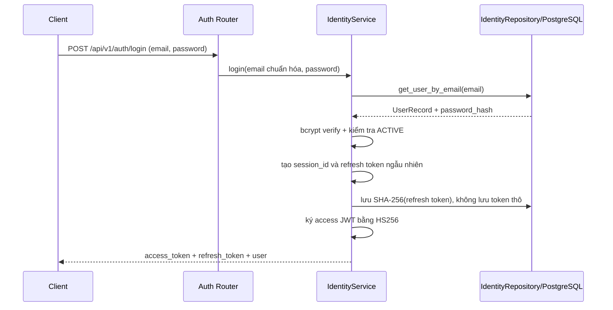
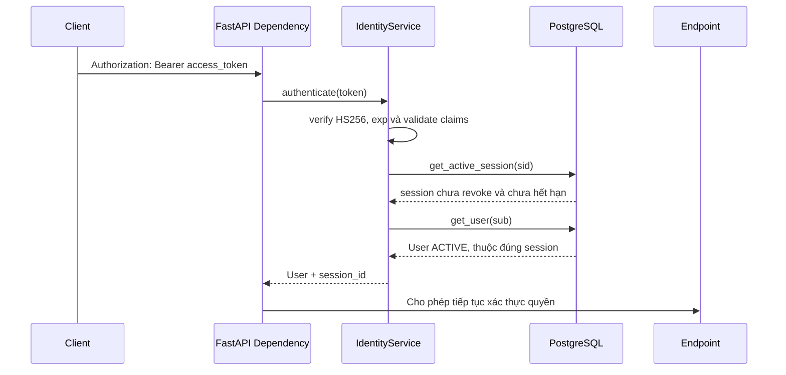
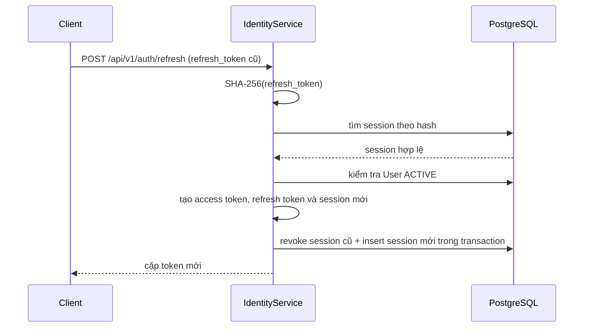

# Luồng đăng nhập, JWT, session và phân quyền RBAC

Tài liệu này mô tả authentication và authorization hiện tại của API. Password
người dùng và credential thiết bị là hai loại dữ liệu khác nhau: Identity không
dùng credential thiết bị để đăng nhập API.

## Mô hình dữ liệu

| Bảng                   | Vai trò                                                  |
| ---------------------- | -------------------------------------------------------- |
| `users`                | Tài khoản, bcrypt password hash, trạng thái và `role_id` |
| `roles`                | Vai trò được gán cho User                                |
| `management_functions` | Nhóm chức năng cần bảo vệ                                |
| `actions`              | Hành động như `View`, `Add`, `Edit`, `Delete`, `Approve` |
| `permissions`          | Một cặp Function–Action                                  |
| `role_permissions`     | Gán Permission cho Role                                  |
| `user_sessions`        | Refresh session, thời hạn và thời điểm revoke            |

Quyền không được nhúng vào JWT. Mỗi request cần quyền sẽ đọc tập permission hiện
tại của Role từ database. Vì vậy thay đổi Role/Permission có hiệu lực mà không
cần phát hành lại access token, miễn là session và user vẫn hợp lệ.

## Luồng đăng nhập



### Quy tắc đăng nhập

1. Router chuẩn hóa email bằng `strip().lower()`.
2. Repository đọc `UserRecord` theo email.
3. `verify_password()` so sánh password với bcrypt hash.
4. User phải có `user_status=ACTIVE`.
5. Backend cập nhật `last_login_at`.
6. Backend tạo một `user_sessions` mới.
7. Client nhận access token ngắn hạn và refresh token dài hạn.

Password thô không được lưu. Public `User` schema không chứa `password_hash`.

## Access token JWT

Access token được ký bằng `AUTH_JWT_SECRET`, thuật toán `HS256`, với các claim:

| Claim | Ý nghĩa                                 |
| ----- | --------------------------------------- |
| `sub` | ID của User                             |
| `sid` | UUID của session trong `user_sessions`  |
| `iat` | Thời điểm phát hành                     |
| `exp` | Thời điểm access token hết hạn          |
| `jti` | ID ngẫu nhiên duy nhất của access token |

Thời gian sống được cấu hình bằng:

```env
AUTH_JWT_SECRET=replace-with-a-random-secret
AUTH_ACCESS_TOKEN_MINUTES=15
AUTH_REFRESH_TOKEN_DAYS=30
```

`AUTH_JWT_SECRET` phải khác `DEVICE_CREDENTIAL_ENCRYPTION_KEY`. Không commit hai
secret này vào Git và không dùng giá trị development trong production.

## Xác thực một request có Bearer token



Chữ ký JWT hợp lệ chưa đủ. Backend còn xác nhận:

- `sid` tồn tại;
- session chưa bị revoke và chưa hết hạn;
- `sub` trùng với `session.user_id`;
- User vẫn tồn tại và đang `ACTIVE`.

Thiếu token, token sai chữ ký, hết hạn hoặc session không hợp lệ trả HTTP `401`.

## Luồng phân quyền RBAC

Route khai báo cặp quyền cần thiết:

```python
Depends(require_permission("Task Management", "Add"))
```

Luồng đầy đủ:

```text
Request + Bearer token
  ↓
get_current_identity
  ├── xác minh JWT
  ├── kiểm tra session
  └── kiểm tra User ACTIVE
  ↓
require_permission(function, action)
  ↓
IdentityRepository.get_permissions(user.role_id)
  ↓ JOIN role_permissions → permissions → functions/actions
  ├── có đúng cặp quyền → gọi endpoint
  └── thiếu quyền        → HTTP 403
```

Phân biệt lỗi:

- `401 Unauthorized`: chưa xác thực được danh tính.
- `403 Forbidden`: đã xác thực nhưng Role không có quyền thực hiện hành động.

## Refresh token và rotation

Refresh token là chuỗi ngẫu nhiên tạo bởi `secrets.token_urlsafe(48)`. Client giữ
giá trị thô; database chỉ lưu SHA-256 digest trong `refresh_token_hash`.



Refresh token rotation bảo đảm token cũ chỉ dùng một lần. Nếu hai request dùng
cùng refresh token, phép cập nhật có điều kiện chỉ cho một request revoke session
cũ; request còn lại nhận lỗi “Refresh token đã được sử dụng”. Client phải thay
cả access token và refresh token sau mỗi lần refresh thành công.

Access token không được lưu vào database. JWT liên kết với session bằng claim
`sid`; do đó revoke session cũng làm access token đang còn hạn bị từ chối ở lần
gọi kế tiếp.

## Logout

```text
POST /api/v1/auth/logout + Bearer token
  ↓ authenticate access token
  ↓ lấy sid
  ↓ đặt user_sessions.revoked_at
  ↓ HTTP 204
```

Sau logout, access token cũ vẫn có chữ ký đúng nhưng không qua được bước kiểm tra
active session. Refresh token thuộc session đó cũng không thể dùng lại.

## Cách Client quản lý token

1. Gọi `/api/v1/auth/login` và nhận hai token.
2. Gửi access token trong `Authorization: Bearer <token>`.
3. Khi access token hết hạn, gọi `/api/v1/auth/refresh` đúng một lần.
4. Ghi đè cả hai token bằng cặp mới trả về.
5. Khi logout, gọi API trước rồi xóa token phía Client.

Đối với frontend trình duyệt production, nên giữ refresh token trong cookie
`HttpOnly`, `Secure`, `SameSite` phù hợp và chỉ giữ access token ngắn hạn trong
memory. API hiện tại trả refresh token trong JSON, nên việc chuyển sang cookie
cần thay đổi HTTP contract và bổ sung bảo vệ CSRF; đây chưa phải hành vi hiện
tại của code.

## API authentication hiện có

| Method | Endpoint               | Yêu cầu                    |
| ------ | ---------------------- | -------------------------- |
| `POST` | `/api/v1/auth/login`   | Public, email và password  |
| `POST` | `/api/v1/auth/refresh` | Refresh token còn hiệu lực |
| `POST` | `/api/v1/auth/logout`  | Access token hợp lệ        |
| `GET`  | `/api/v1/auth/me`      | Access token hợp lệ        |

## File code tương ứng

- `src/app/domains/identity/routers/auth.py`: login, refresh, logout và `/me`.
- `src/app/domains/identity/routers/dependencies.py`: đọc bearer token và kiểm
  tra permission.
- `src/app/domains/identity/services/identity.py`: quy tắc token/session/RBAC.
- `src/app/domains/identity/repositories/identity.py`: truy vấn User, Permission
  và UserSession.
- `src/app/domains/identity/utils/security.py`: bcrypt và SHA-256.
- `src/app/core/config/settings.py`: secret và thời hạn token.

## Checklist bảo mật khi triển khai

- Dùng HTTPS cho mọi request chứa password hoặc token.
- Sinh `AUTH_JWT_SECRET` đủ dài, ngẫu nhiên và quản lý bằng secret manager.
- Không log request body của login/refresh hoặc header Authorization.
- Không lưu refresh token thô trong database/log.
- Giữ access token ngắn hạn và rotate refresh token.
- Thu hồi session khi logout, vô hiệu hóa tài khoản hoặc phát hiện sự cố.
- Bảo vệ mọi route nghiệp vụ bằng `get_current_identity` hoặc
  `require_permission`; không chỉ ẩn nút trên frontend.
- Các route `/api/v1/credentials` phải giữ RBAC `Device Management`: `View` cho
  đọc, `Add` cho tạo và `Edit` cho cập nhật. Audit user lấy từ JWT.
- Kiểm thử riêng trường hợp 401, 403, token hết hạn, session revoke và refresh
  token bị dùng lại.
