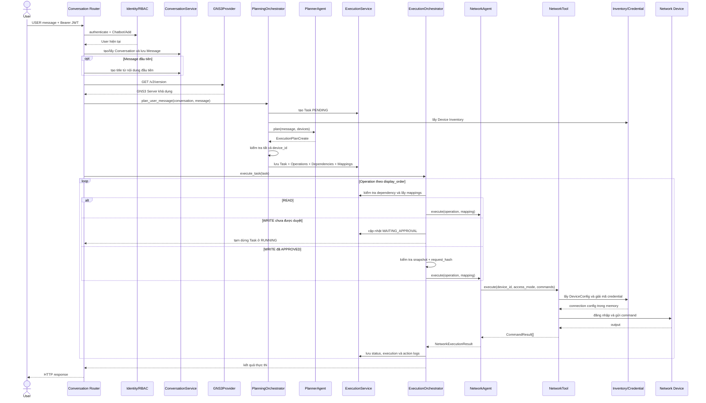

# Luồng end-to-end từ yêu cầu người dùng đến khi thực thi hoàn tất

Tài liệu mô tả luồng đang được triển khai trong backend: từ lúc Client gửi yêu
cầu tiếng Việt, hệ thống xác thực người dùng, lập kế hoạch, kiểm tra approval,
kết nối thiết bị, thực thi command và lưu kết quả.

## 1. Tổng quan

```text
Client
  ↓ USER message + Bearer access token
Conversation Router
  ├── Authentication + Chatbot/Add
  ├── tạo/lấy Conversation
  ├── lưu USER_REQUEST Message
  ├── tạo title nếu là message đầu tiên
  └── kiểm tra GNS3 Server
       ↓
PlanningOrchestrator
  ├── tạo Task
  ├── đọc Device Inventory
  ├── gọi Planner Agent
  └── lưu Operation + Dependency + Operation Device
       ↓
ExecutionOrchestrator
  ├── kiểm tra DAG dependency
  ├── READ  → thực thi ngay
  └── WRITE → kiểm tra Approval
                 ├── PENDING/missing → tạm dừng WAITING_APPROVAL
                 ├── REJECTED/EXPIRED → không thực thi
                 └── APPROVED + snapshot/hash hợp lệ
                              ↓
Network Agent
  ↓
NetmikoNetworkTool hoặc NornirNetworkTool
  ↓ giải mã credential theo nhu cầu
Thiết bị mạng
  ↓ command output
ExecutionOrchestrator
  └── cập nhật Task/Operation/Execution/Action Log
```

## 2. API bắt đầu luồng

### Conversation mới

```http
POST /api/v1/conversations/messages
Authorization: Bearer <access_token>
Content-Type: application/json

{
  "message": "Kiểm tra routing table trên P1"
}
```

Conversation chỉ được tạo khi người dùng thực sự gửi message đầu tiên. Backend
tạo `Conversation` và `USER_REQUEST Message` trong một transaction, sau đó gọi
LLM tạo title ngắn. Nếu title generator lỗi hoặc timeout, generator dùng title
fallback; dữ liệu nguồn không bị mất.

### Conversation đã tồn tại

```http
POST /api/v1/conversations/{conversation_id}/messages
Authorization: Bearer <access_token>
Content-Type: application/json

{
  "sender_by": "USER",
  "message": "Kiểm tra thêm OSPF neighbor trên P1"
}
```

Chỉ message có `sender_by=USER` mới kích hoạt AI workflow. Message của `AGENT`
chỉ được lưu, không tạo Task mới, nhờ đó tránh vòng lặp message tự kích hoạt
Agent.

Hai API yêu cầu quyền:

```text
Chatbot / Add
```

User được xác định từ JWT và active session. Client không được truyền `user_id`
để mạo danh chủ sở hữu Conversation hoặc Task.

## 3. Sequence diagram đầy đủ



Nhánh `NetworkTool → Device` chỉ xảy ra với READ hoặc WRITE đã vượt qua approval
gate. Một WRITE đang chờ phê duyệt tuyệt đối không được giải mã credential và
không được mở kết nối thiết bị.

## 4. Planning: từ Message thành execution plan

`PlanningOrchestrator.plan_user_message()` xử lý theo thứ tự:

1. Kiểm tra Message do `USER` gửi.
2. Kiểm tra Message thuộc đúng Conversation.
3. Tạo `Task` và liên kết với `source_message_id`.
4. Đọc danh sách Device hiện có từ Inventory.
5. Gọi Planner Agent với yêu cầu người dùng và inventory hợp lệ.
6. Nhận `ExecutionPlanCreate` gồm Task type và danh sách Operation.
7. Từ chối kế hoạch nếu LLM trả một `device_id` không có trong inventory.
8. Lưu nguyên tử Task đã planning cùng:
   - `task_operations`;
   - `operation_dependencies`;
   - `task_operation_devices`.

Planner chỉ chọn thiết bị và tạo command dự kiến. Planner không kết nối thiết
bị, không đọc credential và không tự thực thi command.

## 5. Execution: thực thi DAG

`ExecutionOrchestrator.execute_task()` đọc Operation theo `display_order` và
kiểm tra dependency:

- `ON_SUCCESS`: Operation trước phải `SUCCESS`.
- dependency hoàn tất: Operation trước phải ở trạng thái kết thúc được chấp nhận.
- dependency không thỏa: Operation và mappings liên quan chuyển `SKIPPED`.

Các Operation đã ở trạng thái kết thúc được bỏ qua khi resume, nên command thành
công trước đó không bị gửi lại thiết bị.

Trạng thái Task khi bắt đầu execution:

```text
PLANNING/PENDING → RUNNING
```

## 6. Nhánh READ

Với mapping có `access_mode=READ`:

1. Mapping chuyển `RUNNING`.
2. Tạo `TaskExecution` trạng thái `RUNNING`.
3. Network Agent lấy command từ `operation_parameters`.
4. Network Tool tải Device và credential.
5. Backend đăng nhập thiết bị.
6. Chạy `send_command` hoặc `netmiko_send_command`.
7. Lưu output và trạng thái.

READ không cần Operation Device Approval.

## 7. Nhánh WRITE và Human Approval

Trước khi thực thi cấu hình, Orchestrator lấy Approval bằng
`operation_device_id`.

### Chưa có hoặc đang chờ Approval

```text
Task                     = RUNNING
TaskOperation            = WAITING_APPROVAL
TaskOperationDevice      = WAITING_APPROVAL
Task.completed_at        = NULL
```

Orchestrator dừng tại Operation hiện tại và không đánh dấu các bước phụ thuộc là
`SKIPPED`. Thời gian chờ người dùng không phải active processing time.

Frontend lấy yêu cầu phê duyệt bằng:

```http
GET /api/v1/operations/{operation_id}/approvals
```

Tại thời điểm viết tài liệu, repository và API đọc/quyết định Approval đã có,
nhưng Planning/Execution Orchestrator **chưa tự tạo** bản ghi
`OperationDeviceApproval` cho WRITE mapping. Vì vậy nếu không có thành phần khác
tạo sẵn Approval đúng snapshot/hash, mapping sẽ dừng an toàn ở
`WAITING_APPROVAL` nhưng danh sách Approval sẽ rỗng và người dùng chưa có bản ghi
để quyết định. Đây là bước còn thiếu để luồng WRITE chạy end-to-end hoàn toàn.

Sau khi người dùng xem command snapshot, quyết định bằng:

```http
POST /api/v1/operation-device-approvals/{approval_id}/decision
Authorization: Bearer <access_token>
Content-Type: application/json

{
  "decision": "APPROVED"
}
```

Hoặc:

```json
{
  "decision": "REJECTED"
}
```

`decided_by` lấy từ access token. Một Approval chỉ được quyết định một lần.

### Tiếp tục sau Approval

Decision API gọi `ExecutionOrchestrator.resume_after_approval()`:

```text
approval.operation_device_id
  → TaskOperationDevice
  → TaskOperation
  → TaskDetail
  → execute_task(TaskDetail)
```

Với `APPROVED`, Orchestrator chỉ thực thi nếu:

- `commands_snapshot` bằng đúng danh sách command sắp gửi;
- `request_hash` bằng SHA-256 canonical hash của mapping ID và command snapshot.

Nếu command bị thay đổi sau lúc duyệt, mapping chuyển `FAILED`, không kết nối
thiết bị. Với `REJECTED` hoặc `EXPIRED`, mapping không được thực thi.

## 8. Network Agent, credential và thiết bị

Network Agent không tự giải mã password. Luồng kỹ thuật:

```text
NetworkAgent
  → NetworkTool
  → NetworkService
  → DeviceConnectionProvider
  → DeviceConfigRepository
  → PostgreSQL pgp_sym_decrypt
  → Netmiko hoặc nornir-netmiko
  → Network Device
```

Backend lựa chọn tool bằng `NETWORK_BACKEND=netmiko|nornir`.

- READ dùng `send_command`.
- WRITE dùng `send_config_set`.
- Netmiko connection luôn được đóng trong `finally`.
- Password, secret và connection object không được lưu trong execution output.

Chi tiết bảo mật credential nằm trong
[network-device-credential-execution-flow.md](network-device-credential-execution-flow.md).

## 9. Dữ liệu được lưu sau thực thi

| Bảng | Dữ liệu được ghi |
| --- | --- |
| `tasks` | Trạng thái tổng thể, loại Task, thời gian bắt đầu/kết thúc |
| `task_operations` | Trạng thái từng bước logic |
| `task_operation_devices` | Kết quả từng Operation trên từng Device |
| `task_executions` | Agent/tool, input kỹ thuật, output, lỗi và duration |
| `device_action_logs` | Command đã gửi, result, phase và trạng thái audit |
| `operation_device_approvals` | Snapshot, hash và quyết định của người dùng |

Khi kết nối thất bại trước lúc command được gửi, hệ thống vẫn lưu lỗi trong
`task_executions` và mapping nhưng không tạo `device_action_logs` khẳng định sai
rằng command đã chạy.

## 10. Cách tổng hợp trạng thái cuối

Operation được tổng hợp từ các mapping:

- tất cả thành công → `SUCCESS`;
- tất cả bị từ chối → `REJECTED`;
- có thành công và có kết quả khác → `PARTIAL_SUCCESS`;
- còn mapping chờ duyệt → `WAITING_APPROVAL`;
- không có thành công và có lỗi → `FAILED`.

Task được tổng hợp từ các Operation:

- tất cả thành công → `SUCCESS`;
- tất cả bị từ chối → `REJECTED`;
- có ít nhất một kết quả thành công → `PARTIAL_SUCCESS`;
- còn chờ Approval → giữ `RUNNING`, chưa đặt `completed_at`;
- còn lại → `FAILED`.

## 11. Xử lý lỗi theo từng giai đoạn

| Giai đoạn | Hành vi hiện tại |
| --- | --- |
| JWT/session không hợp lệ | HTTP 401, không lưu Message |
| Thiếu `Chatbot/Add` | HTTP 403, không lưu Message |
| GNS3 Server không truy cập được | HTTP 503; Message đã lưu nhưng chưa gọi Planner |
| Planner/LLM lỗi | Request lỗi; Task đã tạo trước lời gọi LLM có thể còn `PENDING` |
| Planner trả Device lạ | Từ chối plan, không lưu Operations |
| Credential/connection lỗi | Mapping và Execution `FAILED` |
| Command thực thi lỗi | Lưu error và tổng hợp trạng thái thất bại/partial |
| Approval đang chờ | Không phải lỗi; Task tạm dừng ở `RUNNING` |
| Approval snapshot sai | Mapping `FAILED`, không gửi WRITE command |

Việc Message được lưu trước GNS3/Planner giúp không mất yêu cầu gốc, nhưng cần cơ
chế retry/recovery riêng cho Task bị dừng do lỗi hạ tầng hoặc LLM.

## 12. Phản hồi hiện tại và Analyst Agent

Source code đã có `AnalystAgent` và prompt trả lời tiếng Việt. Tuy nhiên, Analyst
hiện **chưa được lắp trong `agents/dependencies.py`, chưa được
`ExecutionOrchestrator` gọi và chưa tạo Message `FINAL_RESPONSE`**.

Vì vậy, “thực thi hoàn tất” trong code hiện tại có nghĩa là:

```text
Task/Operation/Mapping đã có trạng thái cuối
+ TaskExecution và DeviceActionLog đã được lưu
```

Nó chưa có nghĩa là Conversation đã nhận câu trả lời tổng hợp từ Analyst.
Response của Conversation API hiện trả Message người dùng hoặc dữ liệu bắt đầu
Conversation sau khi pipeline đồng bộ kết thúc/tạm dừng.

Luồng cần bổ sung sau này để hoàn thành trải nghiệm Chat UI:

```text
Execution results
  → AnalystAgent.analyze()
  → tạo AGENT Message loại FINAL_RESPONSE
  → tạo FINAL_RESPONSE_CREATED activity event
  → frontend tải/nhận message trả lời
```

## 13. API dùng để quan sát luồng

```http
GET /api/v1/tasks/{task_id}
GET /api/v1/tasks/{task_id}/activity-events
GET /api/v1/operations/{operation_id}/approvals
GET /api/v1/conversations/{conversation_id}/messages
```

`task_activity_events` và API timeline đã tồn tại, nhưng các Orchestrator hiện
chưa ghi đầy đủ event ở từng bước. Vì vậy Chat UI chưa thể dựa hoàn toàn vào bảng
này để hiển thị mọi hoạt động của Agent cho đến khi event writer được nối vào
Planning/Execution/Analyst flow.

Hai phần còn thiếu để toàn bộ trải nghiệm Chat UI hoàn chỉnh là:

1. Tự tạo Approval Request và activity event khi WRITE bắt đầu chờ duyệt.
2. Gọi Analyst Agent và lưu `FINAL_RESPONSE` sau khi Task đạt trạng thái cuối.

## 14. File code chính

- `src/app/domains/conversation/routers/conversation.py`: điểm bắt đầu HTTP.
- `src/app/agents/orchestrator/planning.py`: Message → Task/plan.
- `src/app/agents/planner/agent.py`: Planner LLM.
- `src/app/agents/orchestrator/execution.py`: DAG, approval và execution.
- `src/app/agents/network/agent.py`: gọi Network Tool.
- `src/app/tools/network/backends/`: Netmiko/Nornir adapters.
- `src/app/domains/inventory/repositories/device_connection.py`: giải mã
  credential theo nhu cầu.
- `src/app/domains/execution/services/execution.py`: business state và
  persistence contract.
- `src/app/agents/analyst/agent.py`: Analyst chưa được nối vào pipeline.

