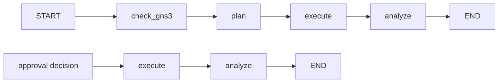

# LangGraph workflow

## Phạm vi

LangGraph sở hữu luồng điều phối cấp cao của AI workflow. Business state vẫn
được lưu bởi các domain service trong PostgreSQL; graph không thay thế các bảng
Task, Operation, Approval, Execution hoặc Activity Event.

## Hai điểm vào

### USER message

`NetworkAutomationWorkflow.run_message()` chạy graph đầy đủ:

1. Kiểm tra GNS3 Server.
2. Tạo và kiểm tra execution plan.
3. Thực thi operation DAG.
4. Phân tích output hoặc tạo message chờ phê duyệt.

### Approval decision

`NetworkAutomationWorkflow.resume_after_approval()` khôi phục Task từ
`operation_device_id` qua PostgreSQL rồi chạy graph resume:

1. Thực thi lại Task từ operation đang chờ.
2. Bỏ qua operation đã kết thúc.
3. Kiểm tra approval snapshot và hash trước WRITE.
4. Phân tích kết quả và tạo phản hồi.

## Ranh giới trách nhiệm

| Thành phần | Trách nhiệm |
| --- | --- |
| LangGraph | Chuyển bước `check_gns3 → plan → execute → analyze` |
| Planning handler | Tạo Task, gọi Planner Agent, kiểm tra và lưu plan |
| Execution handler | Chạy operation DAG, approval gate và audit |
| Analysis handler | Gọi Analyst Agent và lưu conversation response |
| Domain service/PostgreSQL | Nguồn sự thật cho business state |

Graph hiện không dùng checkpointer riêng. Việc chờ approval có thể kéo dài nên
Task được phục hồi từ PostgreSQL trong một graph invocation mới. Cách này tránh
trạng thái Task/Approval trong database lệch với một checkpoint độc lập.
