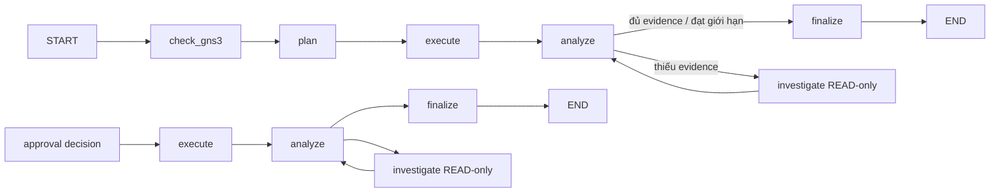

# LangGraph workflow

## Phạm vi

LangGraph sở hữu luồng điều phối cấp cao của AI workflow. Business state vẫn
được lưu bởi các domain service trong PostgreSQL; graph không thay thế các bảng
Task, Operation, Approval, Execution hoặc Activity Event.

## Hai điểm vào

### USER message

`NetworkAutomationWorkflow.run_message()` chạy graph đầy đủ:

1. Kiểm tra GNS3 Server.
2. Tạo và kiểm tra execution plan.
3. Thực thi operation DAG.
4. Phân tích output hoặc tạo message chờ phê duyệt.

### Approval decision

`NetworkAutomationWorkflow.resume_after_approval()` khôi phục Task từ
`operation_device_id` qua PostgreSQL rồi chạy graph resume:

1. Thực thi lại Task từ operation đang chờ.
2. Bỏ qua operation đã kết thúc.
3. Kiểm tra approval snapshot và hash trước WRITE.
4. Phân tích kết quả và tạo phản hồi.

## Ranh giới trách nhiệm

| Thành phần | Trách nhiệm |
| --- | --- |
| LangGraph | Chuyển bước `check_gns3 → plan → execute → analyze`, rẽ nhánh sang `investigate` hoặc `finalize` |
| Planning handler | Tạo Task, gọi Planner Agent, kiểm tra và lưu plan |
| Execution handler | Chạy operation DAG, approval gate và audit |
| Analysis handler | Gọi Analyst, tạo check READ-only khi thiếu evidence và chỉ lưu response tại `finalize` |
| Domain service/PostgreSQL | Nguồn sự thật cho business state |

Với tác vụ chẩn đoán, `analyze` trả thêm `confidence`, `evidence_gaps` và
`suggested_checks`. Nếu bằng chứng chưa đủ, workflow nối các Operation READ vào
Task hiện tại, thu thập dữ liệu trên thiết bị nghi ngờ hoặc láng giềng một hop
từ topology GNS3 rồi quay lại `analyze`. Workflow dừng khi đủ bằng chứng, không
còn check hợp lệ hoặc đạt `AGENT_MAX_INVESTIGATION_ROUNDS` (mặc định 2, tối đa
5). Lệnh bổ sung bị giới hạn ở `show`, `ping` và `traceroute`.
Ngưỡng đủ tin cậy lấy từ `AGENT_DIAGNOSIS_CONFIDENCE_THRESHOLD` (mặc định
`0.8`). Các lần Analyst sửa JSON dùng `ANALYST_VALIDATION_RETRIES` và toàn bộ
lượt phân tích bị giới hạn bởi `ANALYST_TIMEOUT_SECONDS`.

Graph hiện không dùng checkpointer riêng. Việc chờ approval có thể kéo dài nên
Task được phục hồi từ PostgreSQL trong một graph invocation mới. Cách này tránh
trạng thái Task/Approval trong database lệch với một checkpoint độc lập.

## Approval timeout (không phụ thuộc phiên Chat)

Mỗi yêu cầu WRITE cần phê duyệt được lưu với `expires_at = requested_at + APPROVAL_TIMEOUT_MINUTES`
(mặc định 15 phút, UTC). Worker chạy trong FastAPI lifespan, quét ngay sau
startup và sau mỗi `APPROVAL_SWEEP_INTERVAL_SECONDS` (mặc định 30 giây).
Không cần trình duyệt đang mở; nếu backend dừng, việc xử lý tiếp tục ở lần
startup kế tiếp. Có thể tắt worker bằng `APPROVAL_SWEEP_ENABLED=false`,
nhưng Task sẽ không tự kết thúc nếu không có worker riêng.

Khi một approval quá hạn:
- Trong cùng một transaction PostgreSQL, khóa các bản ghi, chuyển mọi
  approval PENDING của Task sang EXPIRED và REJECTED/SKIPPED các mapping chưa chạy.
  **Không thực thi bất kỳ lệnh WRITE nào chưa được phê duyệt.**
- Chốt các operation chưa hoàn tất, giữ lại operation/mapping đã có kết quả.
- Đặt Task thành FAILED nếu chưa có bước thành công; ngược lại PARTIAL_SUCCESS.
  Luôn ghi `completed_at`, tạo một activity với
  `event_data.reason = "APPROVAL_TIMEOUT"`.
- Nếu có Benchmark Run RUNNING liên kết, đánh dấu FAILED và giữ nguyên
  `cleanup_required` để tránh bỏ qua quá trình phục hồi topology GNS3.
  Không sinh evaluation PASS/FAIL giả cho lần chạy chưa kết thúc.
- Các approval cũ có `expires_at = NULL` được tính deadline từ
  `requested_at + APPROVAL_TIMEOUT_MINUTES`. Quyết định đến muộn trả HTTP 409.

Worker dùng row lock/skip locked để tránh nhiều process API kết thúc một Task
lặp lại. Sau khi hết hạn, không thể tiếp tục Task đó bằng API approval cũ.
