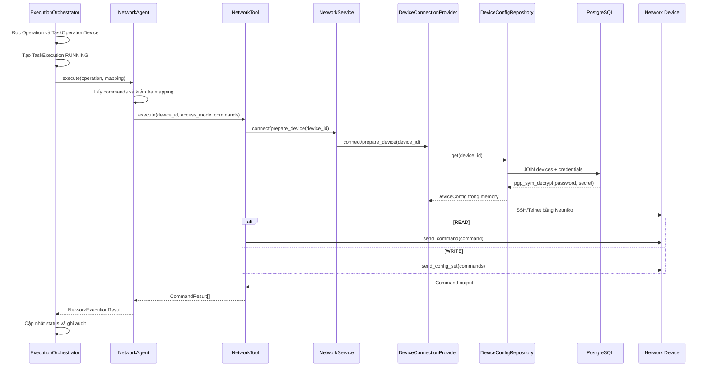

# Luồng credential, đăng nhập thiết bị và thực thi cấu hình

Tài liệu này mô tả luồng hiện tại từ kế hoạch của Planner đến lúc command được
gửi vào thiết bị bằng Netmiko hoặc Nornir. Credential trong luồng này là
credential của **thiết bị mạng**, độc lập với tài khoản đăng nhập API.

## Nguyên tắc bảo mật

- AI Agent không nhận khóa mã hóa và không tự giải mã credential.
- Password và enable secret được mã hóa trước khi lưu PostgreSQL.
- Public Credential API chỉ trả metadata, không trả plaintext hoặc ciphertext.
- Credential chỉ tồn tại ở dạng plaintext trong memory của backend trong thời
  gian chuẩn bị và duy trì kết nối.
- Không đưa password, secret hoặc khóa mã hóa vào prompt, log, execution output,
  activity event hay `device_action_logs`.
- Khóa `DEVICE_CREDENTIAL_ENCRYPTION_KEY` chỉ được backend đọc từ môi trường.

## Thành phần tham gia

| Thành phần | Trách nhiệm |
| --- | --- |
| `ExecutionOrchestrator` | Đọc Operation/mapping, quản lý trạng thái và ghi audit |
| `NetworkAgent` | Kiểm tra input và gọi `NetworkTool` |
| `NetmikoNetworkTool` | Kết nối trực tiếp, gửi command và đóng kết nối |
| `NornirNetworkTool` | Tạo inventory tạm trong memory và chạy `nornir-netmiko` |
| `NetworkService` | Public service che giấu provider kết nối khỏi Agent/Tool |
| `DeviceConnectionProvider` | Chuẩn bị tham số và mở kết nối Netmiko |
| `DeviceConfigRepository` | Đọc Device, join Credential và giải mã bằng pgcrypto |
| PostgreSQL | Lưu metadata Device và ciphertext Credential |

## Luồng lưu credential

```text
Client quản trị
  │ POST/PATCH /api/v1/credentials
  ▼
Credential Router
  │ xác thực JWT và kiểm tra quyền Device Management
  ▼
CredentialService
  ▼
CredentialRepository
  │ pgp_sym_encrypt(..., DEVICE_CREDENTIAL_ENCRYPTION_KEY)
  ▼
PostgreSQL credentials.password / credentials.secret
  └── chỉ lưu ciphertext đã armor
```

`CredentialRepository.create()` và `update()` tạo biểu thức SQL
`pgp_sym_encrypt` với `cipher-algo=aes256`. Các API lấy Credential sử dụng schema
`Credential`, chỉ đọc metadata và không đọc hai cột bí mật.

Các route đọc yêu cầu `Device Management / View`, route tạo yêu cầu `Add` và
route cập nhật yêu cầu `Edit`. `created_by` và `last_updated_by` được lấy từ User
đã xác thực trong JWT, không nhận từ request body để tránh giả mạo audit.

## Luồng thực thi command trên thiết bị



### 1. Lấy Operation và mapping

`ExecutionOrchestrator.execute_task()` duyệt Operation theo `display_order`, kiểm
tra dependency rồi gọi `execute_network_operation()`. Mỗi
`TaskOperationDevice` cho biết:

- `device_id`: thiết bị cần truy cập;
- `access_mode`: `READ` hoặc `WRITE`;
- trạng thái thực thi riêng trên thiết bị đó.

Trước khi gọi thiết bị, Orchestrator chuyển Task, Operation và mapping sang trạng
thái đang chạy, đồng thời tạo `TaskExecution` với input gồm ID thiết bị, access
mode và command. Input này tuyệt đối không chứa credential.

### 2. Network Agent gọi Tool

`NetworkAgent.execute()`:

1. Xác nhận mapping thuộc đúng Operation.
2. Lấy `command` hoặc `commands` từ `operation_parameters`.
3. Chuyển lời gọi blocking của Tool sang worker thread bằng
   `asyncio.to_thread()`.
4. Chuẩn hóa thành `NetworkExecutionResult.SUCCESS` hoặc `FAILED`.

Network Agent không gọi database, pgcrypto, Netmiko hay Nornir trực tiếp.

### 3. Giải mã credential theo nhu cầu

`DeviceConfigRepository.get()` tìm Device bằng `device_id` hoặc hostname, join
với Credential qua `devices.credential_id`, sau đó yêu cầu PostgreSQL thực hiện:

```sql
pgp_sym_decrypt(dearmor(credentials.password), encryption_key)
pgp_sym_decrypt(dearmor(credentials.secret), encryption_key)
```

Kết quả được ánh xạ vào `DeviceConfig`. Đây là ranh giới duy nhất hiện tại làm
plaintext password và secret xuất hiện trong ứng dụng. Không lưu `DeviceConfig`
trở lại database và không serialize nó qua public API.

Nếu Device không tồn tại, chưa gán credential, hoặc giải mã thất bại, provider
không mở kết nối và kết quả thực thi được đánh dấu lỗi.

### 4. Đăng nhập và vào enable mode

Với backend Netmiko, `DeviceConnectionProvider.connect()` chuyển `DeviceConfig`
thành tham số cho `ConnectHandler`, bổ sung timeout từ Settings và mở kết nối.
Nếu có `secret` và phiên chưa ở enable mode, provider gọi `connection.enable()`.

Với backend Nornir, `NornirNetworkTool` lấy cùng `DeviceConfig`, tạo inventory
động trong memory và truyền credential qua `ConnectionOptions` cho plugin
`nornir-netmiko`. Không tạo file inventory YAML chứa secret.

Backend được chọn bằng:

```env
NETWORK_BACKEND=netmiko
# hoặc
NETWORK_BACKEND=nornir
NORNIR_NUM_WORKERS=20
```

### 5. Thực thi READ hoặc WRITE

- `READ`: chạy từng command bằng `send_command` hoặc
  `netmiko_send_command`.
- `WRITE`: gửi danh sách command bằng `send_config_set` hoặc
  `netmiko_send_config`.

Netmiko backend luôn gọi `disconnect()` trong `finally`. Tool chỉ trả command và
output; connection object và credential không đi ngược trở lại Agent.

### 6. Lưu kết quả và audit

Sau khi Network Agent trả kết quả, Orchestrator cập nhật:

- `task_operation_devices`: kết quả trên từng Device;
- `task_executions`: input kỹ thuật, output, thời lượng và lỗi;
- `device_action_logs`: command, kết quả, phase và trạng thái;
- `task_operations` và `tasks`: trạng thái tổng hợp.

Nếu chưa gửi được command thì không tạo `device_action_logs` khẳng định sai rằng
command đã chạy. Lỗi vẫn được lưu trong execution và mapping.

## Approval đối với cấu hình WRITE

Database và API sử dụng `operation_device_approvals`, với quyết định cuối cùng
`APPROVED` hoặc `REJECTED`. `ExecutionOrchestrator` áp dụng approval gate trước
khi chuyển mapping WRITE sang `RUNNING`:

```text
WRITE mapping
  ├── chưa có approval hoặc PENDING → WAITING_APPROVAL, không kết nối thiết bị
  ├── REJECTED/EXPIRED             → không thực thi
  └── APPROVED + snapshot hợp lệ   → mới cho phép Network Agent thực thi
```

Ngoài kiểm tra trạng thái, Orchestrator đối chiếu `request_hash` và
`commands_snapshot` với command sắp chạy để ngăn thay đổi command sau khi người
dùng đã phê duyệt. Hash là SHA-256 của UTF-8 canonical JSON sau:

```json
{"commands":["command 1","command 2"],"operation_device_id":"opdv-..."}
```

Canonical JSON sắp xếp key, không có whitespace thừa và giữ nguyên thứ tự
command. Thành phần tạo Approval phải dùng chung
`build_approval_request_hash()` với Orchestrator.

Nếu chưa có Approval hoặc đang `PENDING`, mapping và Operation chuyển sang
`WAITING_APPROVAL`; Task giữ `RUNNING`, không có `completed_at`, không gọi
Network Agent và không chạy các Operation phụ thuộc phía sau. Khi chạy lại Task
sau quyết định `APPROVED`, các mapping đã hoàn tất không bị thực thi lại.

API quyết định Approval tự gọi `resume_after_approval()`. Orchestrator đọc lại
mapping → Operation → Task từ database rồi tiếp tục DAG; frontend không phải gọi
thêm một API thực thi riêng.

Nếu Approval bị `REJECTED`/`EXPIRED`, mapping không được gửi xuống thiết bị. Nếu
snapshot hoặc hash không khớp, mapping chuyển `FAILED` với lỗi an toàn.

## File code tương ứng

- `src/app/agents/dependencies.py`: lắp backend và khóa giải mã.
- `src/app/agents/orchestrator/execution.py`: điều phối trạng thái và audit.
- `src/app/agents/network/agent.py`: gọi Network Tool.
- `src/app/domains/inventory/repositories/device_connection.py`: truy vấn và
  giải mã credential.
- `src/app/domains/inventory/providers/device_connection.py`: mở kết nối.
- `src/app/domains/execution/utils/approval.py`: canonical hash cho Approval.
- `src/app/tools/network/backends/netmiko.py`: backend Netmiko.
- `src/app/tools/network/backends/nornir.py`: backend Nornir.

