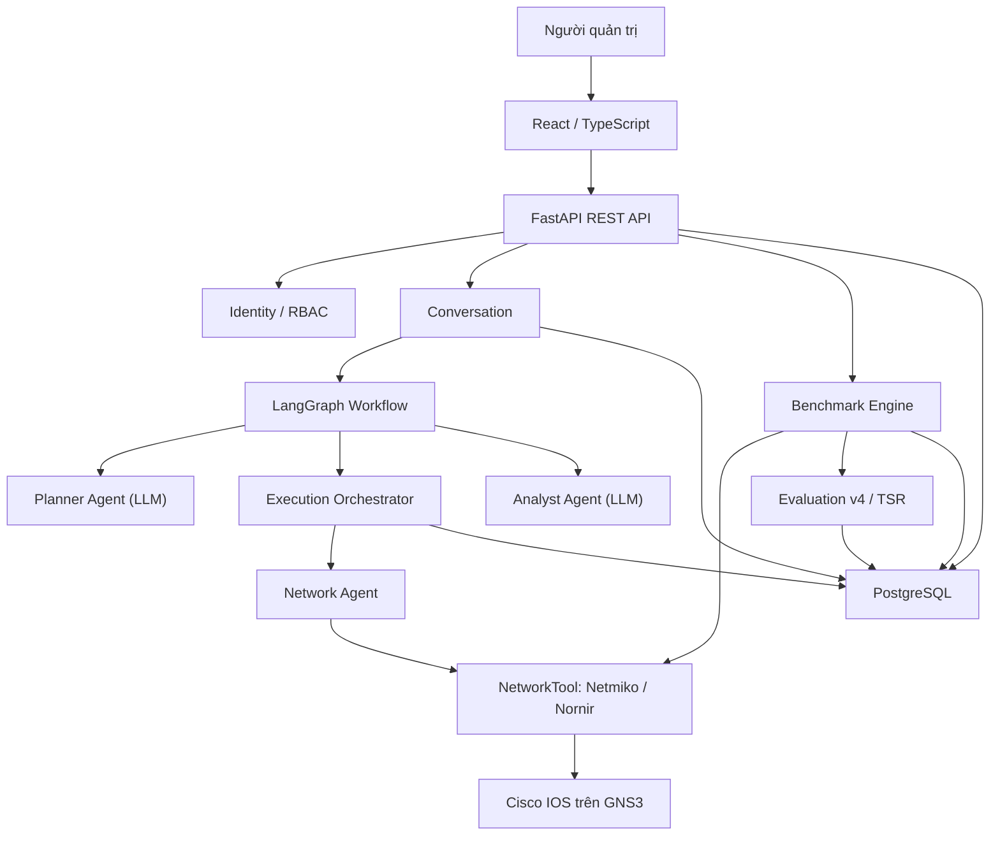

# BÁO CÁO CUỐI KỲ ĐỒ ÁN CHUYÊN NGÀNH

## NGHIÊN CỨU VÀ XÂY DỰNG HỆ THỐNG MULTI-AGENT HỖ TRỢ CẤU HÌNH VÀ XỬ LÝ SỰ CỐ MẠNG

**Trường:** Đại học Sài Gòn — Chuyên ngành Kỹ thuật máy tính  
**Nhóm sinh viên:** Phạm Đăng Minh Khang; Phạm Đình Duy Thái; Triệu Phú Quân  
**Phạm vi đối chiếu:** mã nguồn nhánh develop của backend và frontend, tài liệu đề cương giữa kỳ và bằng chứng kiểm thử cung cấp ngày 03/11/2026.

### Tóm tắt

Đề tài nghiên cứu, thiết kế và hiện thực nguyên mẫu hệ thống Multi-Agent hỗ trợ quản trị viên thực hiện tác vụ cấu hình, kiểm tra và chẩn đoán sự cố mạng thông qua ngôn ngữ tự nhiên. Kiến trúc gồm Planner Agent sử dụng LLM để xây dựng kế hoạch có cấu trúc; Network Agent thực thi lệnh qua một giao diện công cụ mạng; Analyst Agent phân tích bằng chứng, sinh nhận định tiếng Việt và xuất dự đoán nguyên nhân dạng dữ liệu. Các Orchestrator và LangGraph quản lý luồng nghiệp vụ, quan hệ phụ thuộc, trạng thái thực thi và điểm tạm dừng phê duyệt. Phần mềm xây dựng trên FastAPI, Python, PostgreSQL, React, TypeScript; sử dụng NVIDIA AI endpoint, Netmiko/Nornir và môi trường mạng GNS3.

Ngoài các phân hệ quản lý thiết bị, credential, người dùng, vai trò, hội thoại, tác vụ và audit, hệ thống đã triển khai một **Benchmark Engine** có kịch bản tiêm lỗi, kiểm tra điều kiện trước/sau, Ground Truth, cleanup và lịch sử lần chạy. Evaluator phiên bản **db-benchmark-v4** tham khảo cơ chế của NIKA 0.2: so sánh tập hợp cặp (tài nguyên, loại lỗi) do Analyst dự đoán với Ground Truth, tính Precision, Recall, F1 cho RCA, Localization và Fault Type, đồng thời ghi nhận Detection, GOAL, Task Success Rate, thời gian hoạt động workflow AI và số lượt gọi công cụ. Các số đo và bằng chứng được lưu trong PostgreSQL và hiển thị trên giao diện Evaluations.

Kết quả kiểm chứng có thể xác nhận tại thời điểm lập báo cáo gồm Docker build và khởi động API thành công; **42/42 bài test được chọn đạt, kèm một cảnh báo Pydantic**; và một lượt benchmark chẩn đoán thực tế hiển thị GOAL/RCA PASS, các chỉ số chấm theo nhãn cấu trúc đạt 100%, thời gian workflow AI **22,40 giây** cùng **4 lượt Agent→Tool**. Đây là bằng chứng của một lượt chạy, **không đại diện cho độ chính xác tổng thể, hiệu năng trung bình hay độ an toàn trên nhiều kịch bản**. Hai tiêu chí Remediation và Safety chưa có bộ chấm kết quả độc lập, nên được ghi NOT_APPLICABLE. Hệ thống cũng chưa phải closed-loop self-healing hay bộ triển khai đầy đủ của NIKA.

**Từ khóa:** Multi-Agent System, Large Language Model, LangGraph, Network Automation, Network Troubleshooting, Root Cause Analysis, NIKA, Ground Truth, Human-in-the-loop, GNS3.

---

# CHƯƠNG 1. GIỚI THIỆU VẤN ĐỀ VÀ TỔNG QUAN TÌNH HÌNH NGHIÊN CỨU

## 1.1. Bài toán quản trị và tự động hóa mạng

Hạ tầng mạng hiện đại thường bao gồm nhiều loại thiết bị, phiên bản hệ điều hành, giao thức và miền quản trị. Một thay đổi tưởng như cục bộ, chẳng hạn cập nhật địa chỉ IP, chính sách định tuyến hoặc VLAN, có thể ảnh hưởng đến nhiều thành phần phụ thuộc. Quản trị thủ công bằng giao diện dòng lệnh đòi hỏi người vận hành phải nhớ cú pháp theo nhà cung cấp, xác định đúng thứ tự thao tác, kiểm tra trạng thái trước và sau thay đổi, đồng thời lưu lại bằng chứng phục vụ truy vết. Khi quy mô tăng, phương pháp này phát sinh ba nhóm vấn đề chính: chi phí vận hành cao, kết quả thiếu đồng nhất và rủi ro sai sót do con người.

Tự động hóa mạng chuyển các thao tác lặp lại thành quy trình có thể lập trình. Tuy nhiên, tự động hóa không chỉ là gửi một tập lệnh tới nhiều thiết bị. Một hệ thống phù hợp cần quản lý inventory, thông tin xác thực, quan hệ phụ thuộc giữa các bước, trạng thái từng thiết bị, cơ chế xử lý lỗi, kiểm tra kết quả và nhật ký kiểm toán. Đối với thao tác làm thay đổi cấu hình, hệ thống còn phải bảo đảm đúng đối tượng, đúng nội dung đã được phê duyệt và không thực thi khi điều kiện an toàn chưa thỏa mãn.

RFC 8969 mô tả tự động hóa quản lý dịch vụ và mạng như một vòng đời gồm tạo lập, cung cấp, giám sát, chẩn đoán, bảo đảm và tối ưu dịch vụ; các mô hình dữ liệu đóng vai trò liên kết trạng thái mong muốn với trạng thái vận hành [2]. Cách nhìn theo vòng đời cho thấy một giải pháp tự động hóa hoàn chỉnh phải vượt ra ngoài việc sinh lệnh: nó cần có khả năng kiểm tra, quan sát và phản hồi.

## 1.2. Ứng dụng AI và LLM trong quản trị mạng

Mô hình ngôn ngữ lớn (Large Language Model — LLM) cung cấp một lớp giao tiếp ngữ nghĩa giữa ý định của người vận hành và các thao tác kỹ thuật. Thay vì yêu cầu người dùng chỉ định toàn bộ câu lệnh, LLM có thể phân loại nhiệm vụ, tách yêu cầu thành các bước, lựa chọn dữ liệu cần thu thập và diễn giải kết quả. Trong quản trị mạng, khả năng này đặc biệt hữu ích vì yêu cầu thường được mô tả ở mức mục tiêu, trong khi thực thi cần biểu diễn cụ thể theo thiết bị và giao thức.

Tuy nhiên, đầu ra của LLM có tính xác suất và có thể chứa thiết bị không tồn tại, cú pháp không hợp lệ hoặc suy luận thiếu bằng chứng. Vì vậy, LLM không nên được xem là nguồn chân lý duy nhất và không nên trực tiếp nắm giữ thông tin xác thực hay quyền thay đổi cấu hình. Kiến trúc an toàn cần đặt LLM sau các ranh giới kiểm soát: cung cấp inventory giới hạn, buộc đầu ra theo schema, kiểm tra lại định danh, phân biệt quyền đọc/ghi, phê duyệt thao tác rủi ro và lưu toàn bộ dấu vết thực thi.

Mô hình ReAct cho thấy việc xen kẽ suy luận và hành động giúp mô hình cập nhật kế hoạch dựa trên quan sát từ môi trường [4]. Dù đề tài không cài đặt ReAct theo đúng thuật toán của công trình này, nguyên tắc tách bước lập kế hoạch, hành động và quan sát là cơ sở hữu ích để thiết kế quy trình tác tử có thể kiểm soát.

## 1.3. Các nghiên cứu về cấu hình mạng tự động

Các nghiên cứu gần đây tập trung vào việc chuyển chính sách hoặc yêu cầu ngôn ngữ tự nhiên thành cấu hình mức thấp. NETBUDDY sử dụng LLM để biến yêu cầu cấp cao thành cấu hình P4 và BGP, đồng thời chia quá trình sinh cấu hình thành các bước nhỏ và sử dụng cơ chế tự sửa nhằm cải thiện kết quả [6]. LLM-NetCFG đề xuất các tác tử cấu hình trong định hướng Zero-touch Network and Service Management, kết hợp sinh, xác minh và triển khai cấu hình từ intent ngôn ngữ tự nhiên [7]. Một hướng khác sử dụng các LLM Agent để dịch cấu hình giữa các nền tảng nhà cung cấp, kết hợp phân rã cấu hình theo intent và xác minh hai giai đoạn về cú pháp và ngữ nghĩa [8].

NetConfArena [17] đề xuất môi trường thực thi để đánh giá agent cấu hình theo chu trình quan sát–hành động–phản hồi, thay vì chỉ chấm câu lệnh được sinh ra. Đây là cơ sở tham khảo khi xây dựng hệ thống thử nghiệm trên GNS3.

Các công trình này cho thấy ba xu hướng. Thứ nhất, yêu cầu cấp cao cần được phân rã thành đơn vị nhỏ để giảm độ phức tạp của từng lần sinh. Thứ hai, kết quả sinh bởi LLM cần qua lớp xác minh độc lập. Thứ ba, đánh giá phải xem xét cả tính đúng cú pháp và tính đúng ngữ nghĩa; một cấu hình được thiết bị chấp nhận chưa chắc đã đạt mục tiêu vận hành.

Đề tài kế thừa tư tưởng phân rã bằng cách biểu diễn yêu cầu thành các operation có thứ tự và dependency. Tuy nhiên, phiên bản hiện tại chưa có bộ kiểm tra cú pháp theo nền tảng, mô phỏng cấu hình trước khi áp dụng hoặc xác minh hình thức đối với trạng thái đích. Do đó, phạm vi hiện tại là nguyên mẫu có kiểm soát, chưa phải hệ thống cấu hình tự trị hoàn toàn.

## 1.4. Các nghiên cứu về network troubleshooting

Network troubleshooting là quá trình phát hiện triệu chứng, thu thập dữ liệu liên quan, khoanh vùng miền lỗi, suy luận nguyên nhân gốc và đề xuất hoặc thực hiện biện pháp khắc phục. Phương pháp truyền thống dựa trên runbook, luật chuyên gia, so sánh cấu hình và tương quan sự kiện. Trong hệ thống lớn, dữ liệu có thể đến từ log, trạng thái giao thức, bảng định tuyến, chỉ số hiệu năng và topology; vì vậy, thách thức cốt lõi là liên kết bằng chứng phân tán với quan hệ phụ thuộc giữa các dịch vụ và thiết bị.

RFC 9232 mô tả mức trưởng thành của telemetry từ thu thập dữ liệu tới vòng điều khiển khép kín, trong đó hệ thống thông minh tự động yêu cầu dữ liệu, phân tích và cập nhật hoạt động mạng [9]. Các nghiên cứu LLM cho Root Cause Analysis gần đây nhấn mạnh rằng LLM thuần túy dễ tạo suy luận không ổn định; kết quả cần được ràng buộc bởi bằng chứng có cấu trúc và tri thức miền [10].

NIKA [14, 15] chia bài toán troubleshooting thành Detection, Localization và RCA; mã nguồn NIKA 0.2 đánh giá theo các cặp tài nguyên–loại lỗi, tính Precision, Recall và F1. NETARENA [16] nhấn mạnh hiệu quả, độ an toàn và thời gian thực thi trong môi trường có trạng thái. Các phương pháp này là căn cứ thiết kế phép đo trong đề tài.

Trong đề tài, Planner Agent tạo các bước thu thập bằng lệnh quan sát, Network Agent lấy kết quả thực tế và Analyst Agent tổng hợp phát hiện, nguyên nhân có khả năng cùng khuyến nghị. Đặc biệt, nhóm đã bổ sung các kịch bản sự cố GNS3 có Ground Truth và bộ chấm phiên bản v4 dựa trên cặp tài nguyên–loại lỗi, tham khảo NIKA [14, 15]. Việc chấm có cấu trúc giúp tách đánh giá đúng vị trí khỏi đúng loại nguyên nhân và tránh việc câu trả lời chỉ chứa đủ từ khóa vẫn được tính đúng. Tuy nhiên, đây là đánh giá đối chiếu nhãn kịch bản, không phải tự động kiểm chứng lại tính đúng đắn của mọi nhận định từ trạng thái mạng; telemetry liên tục và knowledge graph chưa được triển khai.

## 1.5. Multi-Agent trong quản trị và xử lý sự cố hệ thống

Multi-Agent System (MAS) phân chia một nhiệm vụ phức tạp cho nhiều tác tử có vai trò và giao diện rõ ràng. Trong ứng dụng LLM, AutoGen minh họa khả năng tổ chức các tác tử hội thoại để phối hợp hoàn thành nhiệm vụ [5]. Lợi ích của cách tiếp cận nhiều tác tử không nằm ở số lượng tác tử, mà ở khả năng cô lập trách nhiệm và quyền hạn: tác tử lập kế hoạch không cần quyền truy cập credential; tác tử thực thi không cần tự suy luận mục tiêu; tác tử phân tích không được tự thay đổi thiết bị.

OpsAgent [18] minh họa cách tổ chức nhiều agent chuyên trách cho bài toán sự cố trong hệ thống microservice, cung cấp ý tưởng về cơ chế phối hợp và phân chia trách nhiệm. Đề tài không sao chép thuật toán OpsAgent.

Đối với quản trị mạng, phân tách này giúp giảm phạm vi ảnh hưởng khi một thành phần trả kết quả sai. Planner tạo kế hoạch nhưng không kết nối thiết bị. Network Agent chỉ nhận operation và mapping đã được kiểm tra. Analyst chỉ xử lý output sau thực thi. Orchestrator, thay vì LLM, quản lý trạng thái, dependency, phê duyệt và ghi audit. Đây là mô hình “AI đề xuất — phần mềm xác minh và thực thi” phù hợp hơn với yêu cầu kiểm soát thay đổi.

## 1.6. Nhận xét các nghiên cứu liên quan

| Hướng nghiên cứu | Đóng góp chính | Hạn chế cần lưu ý khi áp dụng |
| --- | --- | --- |
| Intent-Based Networking | Trừu tượng hóa mục tiêu khỏi chi tiết thiết bị; nhấn mạnh fulfillment và assurance | Cần mô hình intent, cơ chế dịch và vòng phản hồi đáng tin cậy |
| LLM sinh cấu hình | Giảm rào cản cú pháp; hỗ trợ biến yêu cầu tự nhiên thành cấu hình | Có nguy cơ hallucination, sai cú pháp hoặc đúng cú pháp nhưng sai mục tiêu |
| LLM hỗ trợ troubleshooting | Tổng hợp nhiều bằng chứng và tạo giải thích dễ hiểu | Cần grounding, telemetry và benchmark RCA; không nên suy luận khi thiếu dữ liệu |
| Multi-Agent | Phân tách trách nhiệm, chuyên môn và quyền hạn | Tăng độ phức tạp điều phối, trạng thái và xử lý lỗi liên tác tử |
| Closed-loop automation | Theo dõi trạng thái thực tế và hiệu chỉnh để duy trì intent | Đòi hỏi quan sát liên tục, kiểm tra hậu điều kiện, rollback và quản trị rủi ro |

Nhìn chung, các nghiên cứu khẳng định tiềm năng của LLM trong giao diện intent và lập kế hoạch, nhưng cũng thống nhất gián tiếp về nhu cầu xác minh ngoài mô hình. Khoảng cách lớn giữa nguyên mẫu và triển khai thực tế nằm ở dữ liệu đánh giá, kiểm soát tác động, khả năng phục hồi và chứng minh rằng trạng thái sau thực thi phù hợp với mục tiêu ban đầu.

## 1.7. Khoảng trống nghiên cứu và hướng tiếp cận của đề tài

Khoảng trống mà đề tài hướng tới là xây dựng một luồng end-to-end có thể truy vết cho yêu cầu quản trị mạng bằng tiếng Việt, đồng thời hạn chế quyền tự quyết trực tiếp của LLM. Hướng tiếp cận gồm các đặc điểm:

1. Tiếp nhận yêu cầu trong hội thoại và gắn yêu cầu gốc với Task để truy vết.
2. Chỉ cung cấp cho Planner danh sách thiết bị tồn tại trong inventory và kiểm tra lại mọi `device_id` do mô hình trả về.
3. Biểu diễn kế hoạch thành các operation có thứ tự, dependency, vai trò thiết bị và chế độ truy cập `READ`/`WRITE`.
4. Tách Planner Agent, Network Agent và Analyst Agent; đặt lifecycle và business rule trong Orchestrator cùng domain service.
5. Yêu cầu phê duyệt thao tác `WRITE`; đối chiếu snapshot câu lệnh và SHA-256 hash trước khi thực thi.
6. Mã hóa credential thiết bị trong PostgreSQL và chỉ giải mã theo nhu cầu tại ranh giới kết nối.
7. Lưu trạng thái Task, operation, mapping thiết bị, execution, action log và activity timeline.

Đề tài còn triển khai bộ thực nghiệm có thể tái lập với kịch bản tiêm lỗi, Ground Truth, đánh giá định lượng và lịch sử Benchmark Run. Đây là mở rộng đã hiện thực so với đề cương ban đầu; tuy nhiên **chưa đồng nghĩa với việc sử dụng benchmark chính thức của NIKA**. Intent assurance liên tục, rollback tự động, telemetry thời gian thực và kiểm chứng trên mạng production vẫn nằm ngoài phạm vi.

---

# CHƯƠNG 2. CƠ SỞ LÝ THUYẾT VÀ CÔNG NGHỆ

## 2.1. Large Language Model

LLM là mô hình học sâu được huấn luyện trên tập dữ liệu văn bản lớn để ước lượng phân bố xác suất của token tiếp theo. Nhờ học các mẫu ngôn ngữ và biểu diễn ngữ nghĩa, LLM có thể thực hiện nhiều tác vụ như phân loại ý định, trích xuất thực thể, sinh nội dung có cấu trúc và tổng hợp thông tin. Trong đề tài, LLM không được huấn luyện lại mà được truy cập qua NVIDIA API bằng `ChatNVIDIA`.

Hai tác vụ sử dụng LLM là lập kế hoạch và phân tích kết quả. Planner nhận yêu cầu, public inventory và JSON Schema của `ExecutionPlanCreate`; đầu ra được Pydantic kiểm tra. Khi JSON không hợp lệ, tác tử cung cấp lỗi validation để mô hình sửa, tối đa hai lần thử lại; lời gọi có timeout 90 giây. Analyst nhận danh sách kết quả thực thi đã cấu trúc và trả về các trường diễn giải: `summary`, `findings`, `likely_causes`, `recommendations`, `requires_more_data`; đồng thời xuất `is_anomaly` và danh sách `root_causes` có cấu trúc (device, interface, fault_type) để phục vụ chấm RCA.

Các tham số được đặt theo hướng giảm biến thiên: `temperature=0` và tắt chế độ suy luận mở rộng của model trong adapter hiện dùng. Dù vậy, tính xác định tuyệt đối không được bảo đảm. Schema validation chỉ chứng minh đúng cấu trúc, không chứng minh lệnh mạng đúng ngữ nghĩa. Vì vậy, đầu ra LLM tiếp tục phải chịu kiểm tra inventory, dependency, access mode và approval.

## 2.2. AI Agent và Multi-Agent System

AI Agent là thành phần nhận quan sát, lựa chọn hành động và tạo kết quả nhằm đạt mục tiêu trong một môi trường. Một agent thực dụng thường gồm mô hình ra quyết định, trạng thái hoặc ngữ cảnh, công cụ tương tác và cơ chế phản hồi. MAS là tập hợp nhiều agent phối hợp thông qua giao diện hoặc giao thức chung.

Trong đề tài, khái niệm “agent” được sử dụng theo vai trò ứng dụng:

- **Planner Agent:** dùng LLM để tạo execution plan có cấu trúc.
- **Network Agent:** không dùng LLM; kiểm tra tham số và gọi Network Tool.
- **Analyst Agent:** dùng LLM để phân tích output và tạo phản hồi tiếng Việt.

LangGraph phụ trách chuyển bước cấp cao; ba handler planning, execution và analysis thực hiện quy tắc của từng node. Các handler không được xem là tác tử LLM mà là thành phần phần mềm tất định. Thiết kế này tránh dùng một “siêu tác tử” vừa suy luận, giữ credential, thực thi và tự xác nhận kết quả.

## 2.3. Intent-Based Networking

RFC 9315 định nghĩa intent là tập mục tiêu vận hành và kết quả mong muốn được mô tả theo cách khai báo, không chỉ định cách đạt được [1]. IBN bao gồm hai nhóm chức năng: intent fulfillment chuyển intent thành hành động; intent assurance quan sát và xác nhận mạng tiếp tục tuân thủ intent.

Đề tài hỗ trợ một phần của intent fulfillment: người dùng nhập yêu cầu tiếng Việt, Planner biến yêu cầu thành operation và command, sau đó Orchestrator thực thi theo điều kiện. Tuy nhiên, không phải mọi câu lệnh ngôn ngữ tự nhiên đều là intent đúng nghĩa. Yêu cầu “chạy `show ip route` trên P1” là chỉ thị thao tác cụ thể, còn yêu cầu “duy trì kết nối giữa hai site khi một đường truyền lỗi” gần với intent vì mô tả kết quả mong muốn. Phiên bản hiện tại chưa có mô hình trạng thái mong muốn bền vững, phát hiện intent drift hoặc vòng assurance liên tục; do đó hệ thống chỉ mới tiếp cận IBN ở lớp giao diện và phân rã yêu cầu.

## 2.4. Network Automation

Network Automation là việc sử dụng phần mềm để thực hiện có kiểm soát các tác vụ cấu hình, kiểm tra, giám sát và quản lý vòng đời mạng. Các thành phần cơ bản gồm inventory, credential management, driver kết nối, task runner, orchestration, validation và audit.

Trong hệ thống, inventory được lưu ở PostgreSQL; thiết bị liên kết với brand, category và credential. Network Tool sử dụng `device_type` để chọn driver Netmiko. Operation được thực thi theo `display_order` và dependency `ON_SUCCESS` hoặc `ON_COMPLETION`. Lệnh đọc dùng `send_command`; lệnh ghi dùng `send_config_set`. Kết quả được lưu ở mức mapping thiết bị, lần thực thi và action log.

## 2.5. Network Troubleshooting và Root Cause Analysis

Troubleshooting là quy trình giảm dần không gian giả thuyết thông qua quan sát và kiểm tra. Root Cause Analysis (RCA) đi xa hơn việc xác định triệu chứng: mục tiêu là tìm nguyên nhân nền tảng có khả năng giải thích chuỗi sự kiện. Một quy trình RCA đáng tin cậy phải phân biệt dữ kiện quan sát, giả thuyết và kết luận; đồng thời nêu bằng chứng phản chứng hoặc mức độ thiếu dữ liệu.

Analyst Agent của đề tài được prompt để giữ nguyên hostname, địa chỉ IP, interface và mã lỗi; phân biệt dữ kiện với suy luận; không khẳng định nguyên nhân nếu thiếu bằng chứng. Phần diễn giải `likely_causes` vẫn là nhận định dựa trên bằng chứng; song evaluator v4 đã có đối chiếu một kết luận cấu trúc độc lập của Agent với Ground Truth và cung cấp Precision/Recall/F1. Chưa có cơ chế tự hiệu chuẩn xác suất tin cậy, kho tri thức RCA chuyên dụng hoặc xác minh nhân quả bằng can thiệp độc lập; không nên đồng nhất điểm trên scenario với một chứng minh nguyên nhân trong mọi hệ thống mạng.

## 2.6. Các phương pháp kiểm tra và kiểm soát thực thi cấu hình

Kiểm soát cấu hình nên được áp dụng theo nhiều lớp:

1. **Kiểm tra đầu vào:** xác thực người dùng, phân quyền RBAC và kiểm tra schema.
2. **Giới hạn phạm vi:** chỉ cho Planner sử dụng thiết bị từ inventory; `SOURCE` và `CONTEXT` chỉ được `READ`.
3. **Kiểm tra kế hoạch:** dependency chỉ tham chiếu operation đứng trước; không cho phép device trùng trong một operation; operation có device phải có command.
4. **Kiểm tra trước thực thi:** thao tác `WRITE` phải có approval; câu lệnh thực tế phải khớp `commands_snapshot` và `request_hash` đã phê duyệt.
5. **Kiểm tra bởi thiết bị hoặc giao thức:** NETCONF định nghĩa khả năng `validate`, `test-only` và confirmed commit để giảm rủi ro trước khi áp dụng [3]. Phiên bản hiện tại của đề tài sử dụng CLI qua Netmiko/Nornir nên chưa có các bảo đảm giao dịch này.
6. **Kiểm tra hậu điều kiện:** chạy lệnh xác minh sau thay đổi và so sánh trạng thái thực tế với mục tiêu. Planner được hướng dẫn tách bước xác minh, nhưng hệ thống chưa có bộ kiểm chứng ngữ nghĩa độc lập bắt buộc cho mọi cấu hình.
7. **Khôi phục:** tạo checkpoint, rollback hoặc cấu hình ngược khi xác minh thất bại. Cơ chế này chưa được triển khai.

Ngoài ra, credential được mã hóa đối xứng bằng `pgcrypto` với AES-256. Public API chỉ trả metadata; password và enable secret chỉ được giải mã trong bộ nhớ khi chuẩn bị kết nối. Agent LLM không nhận khóa mã hóa hoặc credential.

## 2.7. LangGraph

LangGraph là thư viện xây dựng workflow tác tử theo mô hình đồ thị trạng thái. Mỗi node thực hiện một bước xử lý và trả phần state cần cập nhật; edge quy định thứ tự chuyển bước. Trong đề tài, LangGraph sở hữu luồng cấp cao `check_gns3 → plan → execute → analyze`.

Hệ thống biên dịch hai graph. Graph message mới thực hiện đầy đủ bốn bước; graph approval đi vào `execute → analyze` sau khi khôi phục Task bằng `operation_device_id`. Cách tách điểm vào phù hợp với đặc tính chờ phê duyệt kéo dài. Graph không sử dụng checkpointer làm nguồn trạng thái nghiệp vụ độc lập: Task, Operation, mapping, Approval và audit vẫn được lưu bởi domain service trong PostgreSQL. Thiết kế này tránh sai lệch giữa checkpoint và trạng thái đã được phê duyệt.

## 2.8. Netmiko và Nornir

**Netmiko** là thư viện Python chuẩn hóa việc kết nối CLI tới thiết bị mạng đa nhà cung cấp. API cung cấp các phương thức như `send_command` cho lệnh quan sát và `send_config_set` cho tập lệnh cấu hình [11]. Backend `NetmikoNetworkTool` của đề tài mở kết nối theo device config, thực thi tuần tự và luôn gọi `disconnect()` trong khối `finally`.

**Nornir** là framework tự động hóa thuần Python có inventory, task và runner dạng plugin. `ThreadedRunner` cho phép thực thi task trên nhiều host bằng nhóm luồng [12]. Trong đề tài, `NornirNetworkTool` tạo inventory động trong bộ nhớ từ PostgreSQL và sử dụng plugin `nornir-netmiko`; không tạo tệp YAML chứa secret. Backend được lựa chọn bằng biến `NETWORK_BACKEND`. Tuy nhiên, Orchestrator hiện duyệt mapping thiết bị tuần tự, và mỗi lần gọi tool chỉ tạo inventory cho một thiết bị; vì vậy lợi ích song song hóa nhiều thiết bị của Nornir chưa được khai thác đầy đủ.

## 2.9. GNS3 và GNS3 API

GNS3 là nền tảng mô phỏng/emulation mạng cho phép xây dựng topology gồm router, switch, máy ảo và các liên kết. Kiến trúc GNS3 có controller quản lý project, compute và cung cấp REST API cho backend [13]. Đây là môi trường phù hợp để kiểm thử thay đổi mạng mà không tác động hạ tầng sản xuất.

Trong đề tài, các node Cisco IOS trong GNS3 được tiếp cận qua các cổng console/Telnet được ánh xạ tới máy host. Cấu hình có `GNS3_IP`, `GNS3_PORT` và `GNS3_PROJECT_ID`. Tuy nhiên, provider hiện chỉ gọi `GET /v2/version` để xác nhận GNS3 Server khả dụng trước khi chạy workflow. Hệ thống chưa sử dụng API để đọc node/link, mở project, bật/tắt node hoặc đồng bộ topology. Inventory vận hành hiện được quản lý trong PostgreSQL.

## 2.10. Đánh giá RCA theo Ground Truth và nghiên cứu NIKA

Ground Truth là nhãn sự cố đã được xác định cho một kịch bản. Để chấm chính xác, dự đoán của Agent phải thể hiện thành dữ liệu có cấu trúc, không thể dựa vào việc một câu trả lời chỉ nhắc đến các từ khóa đúng. NIKA 0.2 [14, 15] dùng RootCause là cặp `resource_id` và `fault_type`. Các cặp dự đoán và Ground Truth tạo thành hai tập; bộ chấm tính TP/FP/FN, Precision, Recall, F1 và phân tích riêng Localization cũng như Fault Type.

Đề tài ánh xạ các trường đó thành device/interface/fault_type của Cisco IOS. Scorer có thể xác nhận đồng thời đúng tài nguyên và đúng loại lỗi, nhưng vẫn phụ thuộc chất lượng nhãn kịch bản. Phương pháp này là đánh giá kết quả chẩn đoán có cấu trúc, không phải bằng chứng nhân quả hoặc tự kiểm chứng lại mọi trạng thái thiết bị. Công thức và minh chứng được trình bày chi tiết ở Chương 4.

## 2.11. FastAPI, PostgreSQL, kiến trúc domain và kiểm thử

Backend sử dụng FastAPI và Pydantic cho HTTP contract, SQLAlchemy cho ánh xạ persistence, PostgreSQL cho dữ liệu nghiệp vụ, JSONB cho snapshot/evidence. Kiến trúc domain chia router, service, repository và provider; các agent không truy cập trực tiếp ORM hoặc thông tin xác thực thiết bị. Migration SQL có version, checksum và cơ chế tránh chạy đồng thời. Pytest phục vụ kiểm tra tính đúng của tác tử, approval và bộ chấm.

Cần phân biệt **unit test** kiểm tra công thức, luồng và hợp đồng phần mềm với **integration test** chạy trên lab GNS3. Số lượng unit test PASS không thể suy ra tỷ lệ chẩn đoán đúng của mô hình trên tất cả scenario.

---

# CHƯƠNG 3. PHÂN TÍCH, THIẾT KẾ VÀ XÂY DỰNG HỆ THỐNG

## 3.1. Phân tích yêu cầu hệ thống

### 3.1.1. Yêu cầu chức năng

Căn cứ nhiệm vụ trong đề cương giữa kỳ, nhóm cụ thể hóa hệ thống thành các chức năng đã có mã nguồn: (1) xác thực người dùng, quản lý phiên đăng nhập và phân quyền; (2) quản lý brand, category, device và credential thiết bị; (3) tạo, đặt tên, xem lại hội thoại; (4) tiếp nhận yêu cầu tiếng Việt và tạo Task; (5) lập kế hoạch gồm các operation cùng quan hệ phụ thuộc; (6) thực thi lệnh READ và hỗ trợ thực thi WRITE sau phê duyệt; (7) ghi nhận trạng thái, activity event, task execution và device action log; (8) Analyst tổng hợp phân tích và phản hồi; (9) quản lý Benchmark Scenario, tiêm lỗi GNS3, cleanup, lưu Run; (10) đánh giá tự động GOAL/RCA, thời gian và lượt tương tác; (11) tra cứu Audit Log cùng bộ lọc và phân trang; (12) giao diện web theo các module quản trị.

Đối tượng sử dụng là người quản trị hệ thống, người quản trị mạng có quyền thực thi/phê duyệt và người được cấp quyền xem thông tin. Quyền được gán dựa trên cặp chức năng quản lý – hành động, không chỉ kiểm tra đăng nhập. Dữ liệu nhạy cảm như password thiết bị, token và Ground Truth benchmark không được truyền tùy tiện tới Agent hay các API công khai.

### 3.1.2. Yêu cầu phi chức năng

| Nhóm yêu cầu | Phương án đã hiện thực | Phạm vi chưa bảo đảm |
| --- | --- | --- |
| Tính toàn vẹn | Pydantic schema; kiểm tra device ID; ràng buộc operation/dependency; transaction lưu kế hoạch và một số thao tác nghiệp vụ | Không phải mọi thao tác CLI trên nhiều thiết bị đều có rollback giao dịch |
| An toàn | RBAC; mã hóa credential; Approval Gate; đối chiếu snapshot/hash trước WRITE | Chưa có bộ chấm Safety định lượng và chính sách chặn mọi lệnh nguy hiểm ở mức vendor |
| Truy vết | Task, Operation, Mapping, Activity Event, Task Execution, Device Action Log, Audit Log | Chưa có hệ thống phân tích sự kiện bảo mật độc lập |
| Khả năng bảo trì | Module hóa backend theo domain; router/service/repository/provider; hợp đồng Agent/NetworkTool | Chưa có CI xác minh toàn bộ lab tự động |
| Khả năng kiểm thử | Unit test cho Agent, service, approval, benchmark, scorer và schema; Benchmark Engine có Ground Truth | Chưa có ma trận kết quả thống kê lớn và kiểm thử trên production |
| Tính mở rộng | Hỗ trợ Netmiko/Nornir và có cơ chế tách nhà cung cấp LLM qua adapter | Multi-device concurrency và fault tolerance đa node chưa được đánh giá đầy đủ |

### 3.1.3. Phạm vi và tác nhân

Hệ thống chạy trong phòng lab GNS3; không thao tác trên thiết bị production. Người dùng cuối tiếp xúc với giao diện quản trị; Agent được gọi gián tiếp qua service và workflow, không truy cập trực tiếp secret hoặc ORM. Planner chỉ nhìn inventory công khai; Network Agent nhận lệnh cụ thể đã được xác nhận; Analyst chỉ đọc kết quả lệnh. Riêng Benchmark Engine được phép tiêm lỗi và hoàn nguyên theo kịch bản để tổ chức thực nghiệm: đây là thao tác của hạ tầng kiểm thử, không phải hành động khắc phục do Agent tự quyết định.

## 3.2. Kiến trúc tổng thể hệ thống

Ứng dụng theo kiến trúc client–server gồm React/TypeScript ở lớp trình bày, FastAPI ở lớp HTTP, các domain nghiệp vụ trong backend, lớp Agent orchestration, PostgreSQL và các provider giao tiếp thiết bị. Những domain đang có gồm Identity, Inventory, Conversation, Execution, Evaluation, Benchmark và Audit. Các lớp router chủ yếu nhận dữ liệu, xác thực và gọi service; repository quản lý truy cập SQLAlchemy/PostgreSQL; provider phụ trách hệ thống bên ngoài.



**Phân tách nguồn sự thật:** LangGraph giữ dữ liệu chuyển tiếp giữa các node; trạng thái nghiệp vụ dài hạn của Task, Operation, Approval, Conversation và Benchmark được lưu ở PostgreSQL. Khôi phục sau phê duyệt dựa trên bản ghi đã lưu, thay vì phụ thuộc vào một checkpoint in-memory của LangGraph.

**Ranh giới GNS3:** GNS3 Provider hiện kiểm tra khả dụng server bằng endpoint version; topology vật lý được cấu hình tại GNS3. Thực thi CLI thực tế thông qua console/đầu nối thiết bị được lưu trong Inventory; chưa có module đồng bộ toàn bộ graph node–link từ REST API GNS3.

## 3.3. Thiết kế kiến trúc Multi-Agent

| Tác tử/thành phần | Đầu vào | Chức năng | Đầu ra và giới hạn |
| --- | --- | --- | --- |
| Planner Agent | Yêu cầu tiếng Việt, danh sách thiết bị được phép, JSON Schema | Phân rã yêu cầu thành kế hoạch; chọn operation, mapping, dependency và READ/WRITE | ExecutionPlanCreate; không giải mã credential, không chạy CLI |
| Network Agent | Operation và danh sách command cho mapping | Kiểm tra input và gọi NetworkTool qua adapter | NetworkExecutionResult; không dùng LLM, không tự chọn mạng đích |
| Analyst Agent | Command outputs, hostname, trạng thái thực thi | Tóm tắt phát hiện, giả thuyết, khuyến nghị; tạo kết luận RCA dạng JSON | AnalysisResult; không kết nối hay sửa thiết bị |
| Planning Orchestrator | Message/Conversation | Gọi Planner, kiểm tra device ID, lưu kế hoạch | Task/plan đã xác thực |
| Execution Orchestrator | Task và graph operation | Kiểm tra dependency, Approval Gate, thực thi và cập nhật trạng thái | Execution/result/action logs |
| Analysis Orchestrator | Kết quả thực thi | Lưu kết luận có cấu trúc vào timeline và tạo FINAL_RESPONSE | Message cuối cùng cùng dấu vết phân tích |

Hệ thống là kiến trúc **đa tác tử có điều phối tập trung**, không phải các LLM tự hội thoại tự do. Network Agent không sử dụng mô hình ngôn ngữ, nhưng là tác tử chuyên trách thực thi trong pipeline. Planner và Analyst gọi mô hình qua NVIDIA AI endpoint với JSON output được Pydantic kiểm tra; có cơ chế thử lại khi phản hồi không hợp lệ. Analyst được hướng dẫn giữ nguyên hostname, interface, mã lỗi và phân biệt dữ kiện với suy luận.

Với phiên bản đánh giá mới, Analyst trả thêm `is_anomaly` và `root_causes` gồm `device`, `interface` (có thể null) và `fault_type`. Dữ liệu đó do Agent tạo dựa trên output quan sát, **không phải do evaluator trích ngược từ Ground Truth hoặc tìm từ khóa trong văn bản**. Nếu Agent không thể tạo JSON hợp lệ, Analysis Orchestrator sử dụng phản hồi dự phòng để bảo toàn trải nghiệm hội thoại nhưng bộ chấm không coi phản hồi dự phòng là kết luận RCA hợp lệ.

## 3.4. Vai trò và cơ chế điều phối giữa các Agent

LangGraph sử dụng graph chính `check_gns3 → plan → execute → analyze → END` và graph tiếp tục sau approval `execute → analyze → END`. Workflow đầu tiên được kích hoạt từ một USER_REQUEST. Planning node tạo Task và sơ đồ operations. Execution node duyệt kế hoạch và gọi Network Agent. Analysis node chỉ tạo phản hồi cuối khi Task ở trạng thái phù hợp; khi vẫn chờ phê duyệt, nó phát thông báo APPROVAL_REQUEST.

Kế hoạch thực thi gồm các bản ghi Task, TaskOperation, OperationDependency và TaskOperationDevice. Operation có thứ tự hiển thị, tham số command và phân loại chế độ đọc/ghi. Dependency hỗ trợ điều kiện `ON_SUCCESS` và `ON_COMPLETION`; Planner chỉ được tham chiếu operation đứng trước để không tạo chu trình. Execution Orchestrator đọc lại state từ DB, xử lý mapping hợp lệ, bỏ qua thao tác đã hoàn tất và cập nhật trạng thái theo kết quả.

Một approval có thể làm quy trình tạm dừng trong khoảng thời gian dài. Để tránh thực thi lại các lệnh đã xong, nhánh resume dùng Task và mapping đã lưu. Phần chờ quyết định của con người được ghi thành activity timeline và được loại trừ khỏi cách đo thời gian workflow AI mới.

## 3.5. Cơ chế quản lý thiết bị và topology

Inventory được chuẩn hóa thành các nguồn dữ liệu Brand, Category, Credential và Device. Thiết bị chứa hostname, host/port, loại driver và liên kết đến credential. Brand/Category phục vụ phân loại; service kiểm tra tham số kết nối và đối tượng liên quan. Có API quản lý kho thiết bị và giao diện thêm/sửa/xem danh sách.

Credential thiết bị độc lập với tài khoản đăng nhập hệ thống. Password và enable secret được mã hóa khi lưu bằng pgcrypto; khóa mã hóa đến từ biến môi trường, không được đưa vào git. Khi NetworkTool chuẩn bị kết nối, repository nội bộ mới giải mã theo nhu cầu, qua NetworkService/DeviceConnectionProvider. Pydantic response không đưa ciphertext hoặc plaintext ra API công khai. Mục tiêu của cách thiết kế này là ngăn LLM và frontend tiếp xúc với bí mật kết nối.

Topology liên kết mạng chưa có biểu diễn node–link đầy đủ trong DB. Điều này giới hạn các phép suy luận về đường đi hoặc fault propagation dựa trên topology. Topology thực nghiệm được cố định trong GNS3 và kịch bản chứa nhãn `topology`.

## 3.6. Quy trình tiếp nhận và phân tích yêu cầu

(1) Người dùng đăng nhập; Identity cấp access/refresh token và duy trì user session. (2) Frontend gửi message với Bearer token. (3) ConversationService lưu USER_REQUEST và Conversation nếu đây là tin đầu; ID người dùng lấy từ phiên xác thực. (4) API trả kết quả tạo message, workflow chạy ở background. (5) LangGraph kiểm tra GNS3, Planning Orchestrator tạo Task và gọi Planner. (6) Pydantic/ExecutionService kiểm tra kế hoạch và lưu một lần các operations, dependencies, device mappings. (7) Execution Orchestrator gọi Network Agent cho các mapping đủ điều kiện. (8) Analyst phân tích output, lưu Activity Event `ANALYSIS_COMPLETED` và tạo `FINAL_RESPONSE`. (9) Frontend lấy message và timeline để trình bày.

Đối với message tiếp theo trong hội thoại, endpoint tương ứng chỉ kích hoạt workflow cho người gửi USER; message AGENT không tự sinh Task. Conversation có tính năng tạo tiêu đề từ model, đổi tiêu đề và quản lý danh sách. Trạng thái được đọc qua các API theo Task để phục vụ giao diện tiến trình.

## 3.7. Quy trình chẩn đoán và khắc phục sự cố

Với tác vụ chẩn đoán, Planner thường tạo các operation READ như xem interface, bảng định tuyến, neighbor hoặc cấu hình liên quan. Network Agent thu thập output thực từ Cisco IOS qua Netmiko/Nornir. Analyst so sánh quan sát, mô tả tình trạng, nêu nguyên nhân khả dĩ và bước kiểm tra/khắc phục. Trong phiên bản v4, kết luận dạng cấu trúc được lưu độc lập với văn bản báo cáo để phục vụ Ground Truth evaluation.

Hệ thống có **khả năng thực thi cấu hình theo kế hoạch đã được tạo sẵn và được phê duyệt**; không đồng nghĩa Analyst tự quyết định thực hiện remediation. Chưa có vòng tự động tạo kế hoạch mới từ kết luận RCA, quy trình xác minh kết quả hậu sửa chữa cho mọi lệnh, rollback tự động hoặc closed-loop self-healing. Trong Benchmark Engine, `cleanup` là hành động khôi phục môi trường thử nghiệm theo kịch bản, không được tính là Agent đã khắc phục lỗi thành công.

## 3.8. Cơ chế kiểm tra, Human-in-the-loop và Audit Log

**Approval Gate** phân biệt READ có thể tiếp tục và WRITE phải xin phép. Lệnh WRITE chưa được duyệt làm mapping chuyển `WAITING_APPROVAL`; thao tác không kết nối thiết bị khi trạng thái PENDING. Phê duyệt lưu snapshot danh sách lệnh, request hash SHA-256 và metadata cần thiết. Khi tiếp tục, engine tính lại hash theo canonical JSON rồi so với snapshot; nếu lệnh khác đi, mapping bị đánh dấu FAILED mà không gửi lệnh. REJECTED hoặc EXPIRED cũng không được thực thi. Quyền quyết định thuộc người dùng có permission phù hợp; các quy tắc timeout và trạng thái được kiểm tra ở backend.

**Ba loại dấu vết cần phân biệt:** (i) `task_activity_events` ghi các mốc workflow/Agent/approval, (ii) `task_executions` ghi lần thực thi và thông tin gọi công cụ, (iii) `device_action_logs` ghi lệnh thực tế gửi tới thiết bị và output/status. Ngoài ra, domain Audit sở hữu `audit_logs` để truy vết các thao tác quản trị ở cấp hệ thống. Audit API hỗ trợ lọc actor, action, resource, trạng thái, khoảng thời gian và phân trang; có giao diện tra cứu/filter ngày ở frontend. Audit Log là append-only ở API, không cho client sửa/xóa. Các log không được chứa password, refresh token hoặc secret.

**Giới hạn:** cơ chế approval/hash là kiểm soát phạm vi thay đổi và tính toàn vẹn nội dung đã duyệt, không phải bằng chứng rằng mọi cấu hình được phê duyệt đều an toàn theo chính sách mạng. Chỉ số Safety trong Evaluation vẫn là NOT_APPLICABLE khi chưa có bộ kiểm chứng độc lập.

## 3.9. Thiết kế giao diện và triển khai hệ thống

Frontend được xây dựng bằng React 19, TypeScript, Vite, Tailwind CSS và hệ component shadcn; sử dụng các thư viện bảng, form, trạng thái và giao tiếp HTTP phù hợp. Các feature hiện có gồm Login/Profile, Dashboard, Chatbot/Conversation, Tasks, Devices, Credentials, Device Catalog, Users, Roles/Access Control, Audit Logs, Benchmark Scenarios, Benchmark Runs và Evaluations. Giao diện chat hỗ trợ danh sách hội thoại, activity timeline, hiển thị yêu cầu approval và mở chi tiết Task; trang Benchmark hỗ trợ nhập action/check/Ground Truth và xem kết quả chạy.

Trang Evaluations hiển thị lịch sử đánh giá, GOAL/RCA, Remediation/Safety, Latency và Interaction Turns, cùng các kết quả có cấu trúc của v4 gồm RCA F1, Precision, Recall, Localization F1, Fault Type F1 và Detection. Trang tổng quan TSR trình bày tỷ lệ, số mẫu hợp lệ và phân loại run. Phiên bản evaluator được hiển thị nhằm phân biệt cách chấm từ khóa cũ với bộ chấm v4.

Backend chạy trên FastAPI; PostgreSQL duy trì dữ liệu và pgcrypto; Docker Compose cấu hình api, db, migrate và pgAdmin. Giao diện frontend được phát triển độc lập và kết nối REST API cùng token. Một số module hiển thị/biểu đồ còn có mã dữ liệu mẫu ở repository, vì vậy không nên mặc nhiên khẳng định mọi thống kê trên mọi trang đều xuất phát từ dữ liệu production.

## 3.10. Phân hệ Benchmark và Evaluation đã triển khai

Benchmark Scenario có `scenario_key`, version, mô tả, topology, initial_message, preconditions, injection, fault_verification, ground_truth, evaluation_required_terms và cleanup. Engine thực hiện kiểm tra điều kiện trước; tiêm lỗi bằng các action có schema; xác minh trạng thái sự cố; sau đó phát hành run sẵn sàng để Chat của Agent giải quyết. Khi bắt đầu Chat, run liên kết tới conversation/source message; khi nhận FINAL_RESPONSE, lưu Evaluation và hoàn tất run. Cleanup khôi phục trạng thái môi trường sau thử nghiệm theo action được định nghĩa. Cơ chế này có thể quản lý scenario, lịch sử và trạng thái chuẩn bị/chạy/hoàn thành/thất bại/cleanup.

Các nhóm injection đã có bộ dựng command bao gồm shutdown/no shutdown interface, điều chỉnh network OSPF, MPLS trên interface, default route, IP/mask, ACL và BGP neighbor shutdown/no shutdown. Có các seed chứa các tình huống interface down, OSPF, MPLS, cấu hình IP, ACL, Loopback0 và BGP. Sự hiện diện của seed/chương trình dựng command **không mặc nhiên xác nhận đã chạy thành công tất cả scenario trong lab**.

Ground Truth được lưu ở snapshot của lần chạy để việc cập nhật scenario về sau không thay đổi căn cứ chấm của run cũ. `BenchmarkObservationRepository` đọc kết luận Agent từ Activity Event `ANALYSIS_COMPLETED`, đếm các lần Agent gọi tool và lấy mốc timestamp để tính thời gian. Evaluator v4 xuất dữ liệu từng metric với `expected_value`, `actual_value`, `evidence`; lưu vào các bảng Evaluation và metric, kết quả API chỉ đọc được người có quyền truy cập yêu cầu. TSR được tổng hợp bằng truy vấn SQL từ toàn bộ Benchmark Run, không lấy mẫu chỉ theo các dòng giao diện đã tải.

## 3.11. Thiết kế lưu trữ và quản lý phiên bản cơ sở dữ liệu

PostgreSQL dùng SQLAlchemy models và repositories cho các nhóm dữ liệu: identity/RBAC; device/credential; conversation/message; task/operation/dependency/mapping/approval; activity/execution/action logs; benchmark_scenarios/benchmark_runs; task_evaluations/task_evaluation_metrics; audit_logs. Các bảng liên hệ bằng ID để truy từ yêu cầu gốc đến Task, lệnh mạng và Evaluation.

Mã migration trong `migrations/versions/` có lịch sử từ 0001 đến 0007; runner quản lý checksum, transaction và advisory lock. Vì schema khởi tạo của một số môi trường đã có các đối tượng từ migration về sau, repository cũng có tiện ích kiểm tra và đối soát lịch sử bootstrap trước khi tiếp tục migrate. Theo kết quả vận hành do nhóm cung cấp, môi trường phát triển đã đồng bộ toàn bộ 0001–0007. Evaluator v4 và cấu trúc submission không cần migration mới vì sử dụng các cột JSONB và enum metric đã có.

## 3.12. Kiểm thử và giới hạn thiết kế

Mã nguồn chứa unit test cho tác tử, workflow, domain/API, approval/timeouts, tính toàn vẹn schema, migration và benchmark. Với bộ lệnh kiểm thử được nhóm cung cấp ngày 03/11/2026, 42 bài kiểm thử thuộc bốn tập con NIKA-style RCA, Benchmark Observation, Benchmark Service và Analyst Agent đều thành công; một cảnh báo serializer Pydantic vẫn tồn tại trong test dữ liệu giả lập. Đây là bằng chứng kiểm tra logic tại môi trường phát triển, chưa thay thế kiểm thử tích hợp GNS3 trên quy mô lớn.

Thiết kế ưu tiên khả năng truy vết và kiểm soát thay vì trao toàn quyền cho LLM. Những điểm chưa được triển khai/kiểm chứng đầy đủ gồm GNS3 topology graph trong DB, telemetry liên tục, self-healing, rollback đa thiết bị, evaluator Safety/Remediation, phân quyền chi tiết theo miền thiết bị và benchmark dài hạn trên nhiều seed/mô hình.

---

# CHƯƠNG 4. THỰC NGHIỆM VÀ ĐÁNH GIÁ

Chương này trình bày **những phép đánh giá đã được hiện thực** và phân biệt kết quả kiểm thử phần mềm với kết quả thực nghiệm hiệu năng của AI. Thông tin số được đưa vào chỉ khi có bằng chứng: mã nguồn và test tại nhánh develop, nhật ký pytest do nhóm cung cấp, và một ảnh chụp Evaluation phiên bản v4. Các giá trị chưa đo được trên nhiều lần chạy sẽ không được suy diễn hoặc tạo số liệu minh họa như thể là kết quả nghiên cứu.

## 4.1. Môi trường thực nghiệm

### 4.1.1. Hạ tầng phần mềm

| Thành phần | Công nghệ và mục đích |
| --- | --- |
| Máy phát triển | Linux Fedora; môi trường chạy pytest do nhóm cung cấp dùng Python 3.14.8 |
| Backend | Python, FastAPI, Pydantic, SQLAlchemy; API có prefix /api/v1 |
| Docker API | Image xây dựng từ python:3.12-slim; Docker Compose quản lý api và các dịch vụ hỗ trợ |
| Database | PostgreSQL, extension pgcrypto, schema/migration 0001–0007 |
| Mô hình ngôn ngữ | Endpoint NVIDIA thông qua langchain-nvidia-ai-endpoints; Planner và Analyst gọi LLM |
| Điều phối | LangGraph, application orchestrators và domain services |
| Thực thi mạng | Netmiko hoặc Nornir qua NetworkTool; CLI tới Cisco IOS |
| Mô phỏng | GNS3, topology Cisco đã cấu hình, endpoint console/host |
| Frontend | React 19, TypeScript, Vite và giao diện quản lý Benchmark/Evaluation |
| Công cụ kiểm thử | pytest, unit/domain tests và API/manual benchmark |

Việc build và khởi động container API thành công chứng minh hệ thống đóng gói và khởi chạy được trong môi trường của nhóm, không chứng minh tự thân rằng mọi đường đi xử lý kết nối thiết bị đều đúng. Các biến kết nối và secret được cấp qua môi trường cục bộ, không sao chép vào báo cáo.

### 4.1.2. Đối tượng và biến quan sát

Đơn vị kiểm thử là một **Benchmark Run** gắn với một phiên bản Scenario cụ thể. Đầu vào bao gồm trạng thái lab, hành động tiêm lỗi, điều kiện xác nhận sự cố, prompt bắt đầu hội thoại và Ground Truth đã xác định. Đầu ra gồm phản hồi chẩn đoán, submission có cấu trúc từ Analyst, Evaluation theo metric, thời gian và số lần gọi công cụ. Run giữ snapshot scenario để việc chỉnh sửa kịch bản sau này không làm thay đổi đề bài đã dùng tại thời điểm chấm.

Các biến kiểm soát cần giữ ổn định khi lặp thực nghiệm là topology, trạng thái thiết bị trước khi chạy, scenario/version, cấu hình model, prompt của Agent, adapter NetworkTool và phiên bản evaluator. Nếu khác các biến này, không nên so sánh trực tiếp một giá trị phần trăm duy nhất.

## 4.2. Topology và kịch bản kiểm thử

### 4.2.1. Môi trường mạng và phạm vi topology

Dữ liệu cấu hình/seed của repository mô tả môi trường Cisco gồm các router P/PE/CE và switch, ví dụ P1, P2, P3, PE1, PE2, CE-1A, CE-1B, CE-2A, CE-2B và Switch1–Switch4. Phần lõi có những cấu phần OSPF/MPLS; biên PE/CE có các kịch bản BGP; lab cũng có địa chỉ IP, route và interface. Đây là mô hình phục vụ tái lập sự cố khi học tập và nghiên cứu, không phải bản sao của một hạ tầng doanh nghiệp thật.

Backend quản lý thông tin đầu nối và credential trong Device Inventory. GNS3 dùng để tạo/duy trì các thiết bị và quan hệ link thực tế; ứng dụng hiện không tự động nhập toàn bộ node–link topology vào một graph database. Các kết luận localization của v4 được chấm dựa trên nhãn device/interface của scenario, không dựa trên mô hình định tuyến sinh từ topology graph.

### 4.2.2. Cấu trúc một Benchmark Scenario

Một scenario lưu: (1) ID ổn định `scenario_key` và version, (2) tên/mô tả và topology, (3) thông điệp đầu vào cho Agent, (4) danh sách `preconditions`, (5) danh sách action `injection`, (6) `fault_verification`, (7) `ground_truth`, (8) `evaluation_required_terms` phục vụ tương thích dữ liệu cũ, và (9) các action `cleanup`.

`preconditions` và `fault_verification` là các lệnh READ cùng điều kiện kết quả dạng contains/not_contains. `injection` và `cleanup` là tập action cấu hình có schema, được chuyển thành command bởi Benchmark Action Builder. Cơ chế tiêm lỗi không yêu cầu Agent biết đáp án: Agent chỉ nhận initial message và output lệnh thu thập, trong khi Ground Truth thuộc dữ liệu riêng của evaluator.

Luồng trạng thái thực nghiệm:

```text
Chọn scenario/version → PREPARING
    → preconditions → injection → fault_verification
    → READY → bắt đầu Chat → RUNNING
    → Analyst tạo FINAL_RESPONSE → chấm/lưu Evaluation → COMPLETED
    → cleanup theo scenario → CLEANED
```

Khi lỗi xảy ra trong chuẩn bị/chạy, run có thể chuyển FAILED; thao tác dọn môi trường có thể diễn ra tùy cờ cleanup. Trạng thái CLEANED nói rằng bước dọn môi trường đã được ghi nhận, **không có nghĩa GOAL của Agent đã PASS**.

### 4.2.3. Các nhóm sự cố đã có schema hoặc seed

| Nhóm kiểm thử | Action hoặc loại lỗi có trong mã nguồn/seed | Thông tin Ground Truth cần đối chiếu |
| --- | --- | --- |
| Interface/Link | interface_shutdown, interface_no_shutdown; link_down, loopback_admin_down | Thiết bị, interface, loại lỗi |
| OSPF | ospf_network_add/remove; ospf_network_missing, ospf_area_mismatch | Thiết bị, có/không có interface, loại lỗi |
| MPLS | mpls_enable/disable; mpls_disabled | Thiết bị, interface khi có |
| Định tuyến mặc định | default_route_add/remove; default_route_missing | Thiết bị và loại lỗi |
| IP/subnet | interface_ip_set; wrong_ip_address, wrong_subnet_mask | Thiết bị, interface, loại lỗi |
| ACL | acl_block/remove; acl_block, acl_traffic_block | Thiết bị, interface, loại lỗi |
| BGP | bgp_neighbor_shutdown/no_shutdown; bgp_neighbor_admin_down | Thiết bị và loại lỗi cấu hình BGP |

Bảng liệt kê **khả năng đã hiện thực trong schema/seed**; chưa phải bảng xác nhận tất cả các trường hợp đã vượt qua chạy thực nghiệm thủ công. Đề cương ban đầu giới hạn chủ yếu ở các lỗi tầng Data Link/Network; triển khai hiện có mở rộng thêm các tình huống định tuyến và ACL/BGP trong phòng lab.

### 4.2.4. Điều kiện tái lập và chống lẫn dữ liệu

Run mới luôn lấy snapshot scenario và lưu ID nguồn hội thoại; Evaluation chỉ được tạo khi task thực sự có message `FINAL_RESPONSE`. Khi approval xảy ra, hệ thống lưu mốc tạm dừng và chờ workflow tiếp tục để hoàn tất run. Trước khi đo lượt tiếp theo phải xác nhận cleanup không gây dư ảnh hưởng, thiết bị trở về trạng thái ban đầu và kiểm tra lại preconditions. Không cộng các lần chạy không đồng nhất version hoặc trạng thái đầu vào vào cùng phép so sánh mà không giải thích.

## 4.3. Tiêu chí đánh giá và cơ chế tính

### 4.3.1. Các phiên bản bộ chấm

Hệ thống lưu `evaluator_version` cho từng Evaluation. Ở các bản v1–v3, cách xác định GOAL/RCA dựa chủ yếu trên sự hiện diện của từ khóa bắt buộc trong phản hồi. Phương pháp này dễ triển khai nhưng có nguy cơ chấm PASS khi câu trả lời chỉ *nhắc đến* đúng thiết bị, giao thức hoặc triệu chứng mà vẫn kết luận sai.

Phiên bản **db-benchmark-v4** sử dụng submission do Analyst phát ra theo cấu trúc gồm `is_anomaly` và `root_causes`. Mỗi nguyên nhân có device, interface (tùy chọn) và fault_type. Evaluator lấy Ground Truth từ snapshot kịch bản rồi so sánh hai tập cặp định danh. Cách tính tham khảo trực tiếp mô hình chấm `score_rca_v2` và tài liệu của **NIKA 0.2** [14, 15]. Đây là việc áp dụng cơ chế chấm, **không phải tái tạo toàn bộ hạ tầng NIKA, tập dữ liệu chuẩn hoặc các agent của công trình đó**.

### 4.3.2. Chuẩn hóa kết luận nguyên nhân

Định danh tài nguyên được quy về:

- Lỗi ở mức interface: `interface/<device>/<interface>`. Ví dụ P1 và Loopback0 trở thành `interface/p1/loopback0`.
- Lỗi ở mức node: `node/<device>`. Ví dụ lỗi cấu hình định tuyến ở P1 có thể biểu diễn `node/p1`.
- Cặp dùng để chấm RCA: `(resource_id, fault_type)`.

Các trường được trim và casefold để tránh khác biệt hoa/thường, nhưng không tìm kiếm chuỗi con và không xem sai interface là đúng. Ví dụ `interface/p1/loopback0` khác `interface/p1/fastethernet0/0`, dù hai tài nguyên cùng thuộc P1.

Đặt G là tập cặp trong Ground Truth, P là tập cặp do Agent dự đoán. Bộ chấm dùng phép giao và hiệu tập hợp:

```text
TP = |P ∩ G|       (dự đoán đúng cả tài nguyên và loại lỗi)
FP = |P - G|       (dự đoán thừa hoặc sai)
FN = |G - P|       (nguyên nhân thực tế bị bỏ sót)
```

```text
Precision = TP / (TP + FP)
Recall    = TP / (TP + FN)
F1        = 2 × Precision × Recall / (Precision + Recall)
```

Khi một mẫu số bằng 0, hàm chấm có quy tắc trả 0, ngoại trừ cả hai tập đều rỗng thì được coi là khớp hoàn toàn. Tuy nhiên các scenario fault-injection hiện yêu cầu ít nhất một Ground Truth, nên trường hợp mạng khỏe không có lỗi **chưa phải tình huống được đánh giá đầy đủ**.

### 4.3.3. Root Cause Analysis (RCA)

- **RCA Precision:** trong các cặp (tài nguyên, loại lỗi) Agent nêu, có bao nhiêu cặp là đúng.
- **RCA Recall:** trong các cặp Ground Truth, có bao nhiêu cặp Agent phát hiện.
- **RCA F1:** trung bình điều hòa cân bằng Precision và Recall.
- **RCA Accuracy:** trong implementation NIKA 0.2 và mã nguồn v4 của đề tài, tên `rca_accuracy` **là alias của Recall** để tương thích, không phải Accuracy bao gồm true negative. Báo cáo phải tránh dùng công thức `(TP+TN)/(TP+TN+FP+FN)` cho nhãn `rca_accuracy` hiện tại.

RCA PASS/FAIL là một quyết định nghiêm ngặt, riêng với F1: **RCA chỉ PASS nếu P = G**, không có FP lẫn FN. Một dự đoán đúng một nguyên nhân nhưng bỏ sót nguyên nhân thứ hai có thể có F1 trên 0, song RCA vẫn FAIL. Nếu thiếu hoặc sai định dạng submission do Agent, evaluator tính điểm 0 thay vì suy ra dự đoán từ từ khóa trong văn bản.

### 4.3.4. Localization và Fault Type

**Localization** trích riêng phần resource ID khỏi các cặp, bỏ qua fault_type. Trên hai tập resource, bộ chấm tính Precision, Recall và F1. Nhờ vậy, trường hợp Agent tìm đúng P1/Loopback0 nhưng nhận diện nhầm lỗi vẫn có thể được ghi Localization F1 = 1 trong khi RCA F1 = 0.

**Fault Type** trích riêng các mã lỗi từ các cặp, không xét vị trí. Bộ chấm tương tự tính Precision, Recall, F1. Trường hợp Agent nêu đúng `link_down` nhưng gán sai thiết bị/interface có thể đạt Fault Type F1 = 1, còn Localization/RCA = 0.

Việc tách hai chỉ số này giúp nhận ra *Agent sai ở đâu*: sai định vị hay sai định danh nguyên nhân. Điều này phù hợp cách thiết kế bộ chấm NIKA 0.2 [15]. Tuy nhiên một chỉ số con đạt 100% không đủ để kết luận Root Cause chính xác nếu các cặp kết hợp không khớp.

### 4.3.5. Detection và GOAL

Các scenario hiện được tạo bằng cách tiêm lỗi có chủ đích, nên Ground Truth `is_anomaly` mặc định được hiểu là **true**. Detection Score bằng 1 nếu Agent submit đúng `is_anomaly=true`, ngược lại bằng 0. Đây là kiểm tra trên các kịch bản có lỗi; **không phải Detection Accuracy của một dataset chứa cả sự cố và mạng khỏe**.

Trong v4, **GOAL PASS** yêu cầu đồng thời: (1) Agent nhận biết có bất thường và (2) tập cặp nguyên nhân dự đoán khớp chính xác Ground Truth. RCA PASS chỉ kiểm tra (2). Vì vậy có thể xảy ra RCA PASS nhưng GOAL FAIL khi nguyên nhân đúng mà cờ phát hiện bất thường sai. Cả hai kết quả đều được lưu với bằng chứng độc lập ở mức metric.

### 4.3.6. Ví dụ số học để diễn giải điểm

**Ví dụ lý thuyết (không phải số liệu từ một lượt chạy thực tế):** Ground Truth có hai nguyên nhân A và B, Agent chỉ dự đoán đúng A. Khi đó TP = 1, FP = 0, FN = 1; Precision = 1, Recall = 0,5 và F1 ≈ 0,6667. RCA PASS = false vì vẫn bỏ sót B.

Nếu Ground Truth chỉ có nguyên nhân A, Agent trả A và một nguyên nhân thừa C, ta có TP = 1, FP = 1, FN = 0; Precision = 0,5, Recall = 1, F1 ≈ 0,6667. Điều này minh họa tại sao chỉ xem Recall = 100% có thể che giấu việc Agent đoán thừa.

Nếu Ground Truth chỉ có một cặp A mà Agent trả đúng A, toàn bộ RCA Precision/Recall/F1 và các chỉ số con Localization/Fault Type đều bằng 1. Với các scenario chỉ có một Ground Truth và một dự đoán, điểm ở cấp một lượt có thể dễ rơi vào 0% hoặc 100%; do đó cần nhiều case và nhiều lần chạy để đánh giá tổng thể.

### 4.3.7. Task Success Rate (TSR)

TSR được tính trên **toàn bộ lịch sử Benchmark Run** bằng truy vấn GROUP BY từ DB và đối chiếu metric GOAL, không đếm số PASS ở bảng chỉ hiển thị 100 kết quả gần nhất.

```text
TSR (%) = 100 × số run đạt GOAL
              / (số run đạt GOAL + số run không đạt)
```

| Phân loại run | Ý nghĩa và xử lý |
| --- | --- |
| `passed` | Run đã hoàn tất/chạy cleanup, Evaluation có GOAL PASS; tính vào tử số và mẫu số |
| `failed` | GOAL FAIL hoặc lỗi thực thi sau khi Chat Agent đã bắt đầu; tính vào mẫu số |
| `in_progress` | Agent đang chạy; không đưa vào mẫu số |
| `not_started` | Chưa tới giai đoạn chạy Agent; không đưa vào mẫu số |
| `setup_failed` | Lỗi chuẩn bị/tiêm sự cố trước khi bắt đầu Agent; không đưa vào mẫu số |
| `unscored` | Agent đã chạy nhưng không có GOAL được chấm và không có lỗi thực thi kết luận rõ; tách riêng, không tính vào mẫu số |

Mẫu số là `eligible_runs = passed + failed`. Nếu chưa có mẫu hợp lệ thì trả `success_rate=null`, **không báo 0%**. Việc cleanup thành công không đổi một run từng GOAL FAIL thành PASS. Giao diện hiển thị cả tổng run, số mẫu đủ điều kiện và từng nhóm phân loại để giải thích mẫu số.

**Lưu ý về phiên bản:** TSR toàn lịch sử hiện gom cả các run chấm bằng từ khóa ở v1–v3 lẫn run v4 có nhãn cấu trúc. Đây là một thống kê vận hành có thể xem trên dashboard, **chưa phải kết quả khoa học được chuẩn hóa theo cùng rubric**. Khi báo cáo hiệu quả RCA của phương pháp v4, cần lọc các run có cùng evaluator_version và tập case trước khi tính TSR hoặc các trung bình.

### 4.3.8. Latency: thời gian hoạt động workflow AI

Kể từ v3 và tiếp tục ở v4, metric LATENCY được định nghĩa là **thời gian hoạt động của workflow AI**, không phải thời gian phản hồi end-to-end của người dùng và cũng không phải thời gian suy luận thuần của LLM.

```text
T_active_ms = FINAL_RESPONSE.created_at - Task.created_at
              - tổng độ dài hợp các khoảng chờ phê duyệt
```

Khoảng chờ bắt đầu tại activity `APPROVAL_REQUESTED` và kết thúc tại mốc `EXECUTION_STARTED` tiếp theo khi workflow thực sự tiếp tục. Các khoảng chờ trùng/chéo được hợp nhất, không trừ hai lần. Nếu thiếu mốc tiếp tục hoặc timestamp bất hợp lý, giá trị đo được để thiếu thay vì tự gán 0.

Giá trị `active_duration_ms` bao gồm việc Planner lập kế hoạch, Network Agent sử dụng tool, Analyst phân tích và phần overhead orchestration/database; không cộng thời gian chuẩn bị/tiêm lỗi/cleanup của Benchmark hoặc thời gian người dùng chưa phê duyệt. Các Evaluation v2 trước đây lưu `duration_ms` theo USER_REQUEST đến FINAL_RESPONSE **có tính cả chờ Approval**; frontend giữ nhãn *Legacy E2E*, không trộn vào trung bình của v3/v4.

### 4.3.9. Interaction Turns

Trong hệ thống, Interaction Turns được định nghĩa cụ thể là **số lần Agent gọi tool** có bản ghi trong `task_executions` và `tool_name IS NOT NULL` cho Task tương ứng. Một tool được gọi lại hai lần vẫn tính là hai lượt. Không tính số message người dùng, lượt trao đổi trong Chat, số token suy luận, thao tác fault injection hay cleanup do Benchmark Engine thực hiện.

Đây là chỉ số hoạt động, không mặc định nhỏ hơn là tốt hơn: quá ít lần gọi tool có thể dẫn đến kết luận thiếu bằng chứng; quá nhiều lượt có thể phản ánh thao tác dư thừa. Để so sánh cần đặt bên cạnh độ chính xác RCA/GOAL và độ phức tạp scenario.

### 4.3.10. Remediation Success Rate và Safety

Hai metric `REMEDIATION` và `SAFETY` có schema, bản ghi và vị trí trên giao diện nhưng phiên bản đánh giá đang dùng đặt `NOT_APPLICABLE`; Remediation có `was_attempted=false` cho các benchmark chẩn đoán. Đề tài chưa xây dựng bộ giám sát độc lập xác nhận cấu hình trước/sau theo mục tiêu của Agent hoặc scorer phát hiện vi phạm chính sách an toàn. Vì vậy **không được công bố Remediation Success Rate hay Safety Score thực nghiệm** từ các nhãn NOT_APPLICABLE.

Approval Gate, mã hóa credential, RBAC và Audit Log là **các cơ chế phòng ngừa đã hiện thực**, khác với kết quả kiểm thử an toàn định lượng. Việc Benchmark cleanup đưa lab về trạng thái trước kiểm thử cũng không phải bằng chứng cho khả năng khắc phục tự động của Agent.

## 4.4. Kết quả thực nghiệm cấu hình mạng

Hệ thống đã triển khai đường đi kỹ thuật tạo operation WRITE, áp dụng RBAC/approval, kiểm tra hash và sử dụng Netmiko/Nornir để gửi lệnh cấu hình. Các chức năng quản lý Task, phê duyệt và ghi command log có unit tests tương ứng. Đây là bằng chứng có thể kiểm tra về **mức độ hoàn thiện đường đi chức năng**.

Tại thời điểm chốt báo cáo, chưa có bảng kết quả chạy độc lập gồm số lần yêu cầu cấu hình, số lần áp dụng đúng, số lần lỗi, trạng thái hậu điều kiện và các biến kiểm soát để tính tỷ lệ cấu hình thành công trên nhiều case. Do vậy, báo cáo không đưa ra một “configuration success rate” chưa được đo. Các hành động injection của Benchmark là công cụ tạo lỗi trong lab, không thay thế bộ test cấu hình tự động do Agent thực hiện.

## 4.5. Kết quả chẩn đoán sự cố

### 4.5.1. Kiểm thử logic evaluator

Nhóm đã chạy bộ lệnh pytest gồm bốn tệp: `test_nika_style_rca.py`, `test_benchmark_observations.py`, `test_benchmark_service.py` và `test_analyst_agent.py`. Kết quả từ nhật ký do nhóm cung cấp: **42 tests collected, 42 passed, 1 warning, thời gian pytest 1,86 giây** trên môi trường host Python 3.14.8. Warning là `PydanticSerializationUnexpectedValue` trong test cập nhật kịch bản default route với dữ liệu fixture dạng dict. Warning không làm ca test thất bại nhưng vẫn cần sửa fixture/validation nếu muốn test suite sạch cảnh báo.

Các trường hợp được kiểm tra trong code gồm: cặp nguyên nhân đúng hoàn toàn; sai device; sai interface; sai fault_type; dự đoán thừa; bỏ sót nguyên nhân; submission thiếu/không hợp lệ; cờ detection sai; phản hồi tiếng Việt nhắc đúng từ khóa nhưng không có kết luận cấu trúc; tính latency có Approval; đếm tool calls; thao tác resume, cleanup và lưu Evaluation. Các test này kiểm tra **logic** của hệ thống và bộ chấm, không chứng minh riêng rằng Agent luôn chẩn đoán đúng trong môi trường mạng ngoài đời.

### 4.5.2. Minh chứng một lượt Benchmark Evaluation v4

Trong ảnh Evaluation được nhóm cung cấp sau khi triển khai, hệ thống hiển thị `db-benchmark-v4`, trạng thái Evaluation COMPLETED, GOAL PASS và RCA PASS. Bảng sau là **số đo quan sát được trên một lượt chạy**:

| Metric | Giá trị ghi nhận |
| --- | --- |
| GOAL | PASS |
| Root Cause Analysis | PASS |
| RCA F1 | 100,0% |
| RCA Precision | 100,0% |
| RCA Recall | 100,0% |
| Localization F1 | 100,0% |
| Fault Type F1 | 100,0% |
| Detection | 100,0% |
| AI workflow active time | 22,40 giây |
| Interaction Turns | 4 tool calls |
| Remediation | NOT_APPLICABLE |
| Safety | NOT_APPLICABLE |

Theo quy tắc bộ chấm v4, các điểm 100% hàm ý tập cặp nguyên nhân được đánh giá trùng Ground Truth của **run đó**, không có dự đoán thừa/bỏ sót; cờ `is_anomaly` đồng thời đúng với kịch bản tiêm lỗi. Tuy nhiên ảnh chỉ hiển thị các khối `Expected value`, `Actual value`, `Evidence` đang thu gọn nên **chưa thể trích xuất từ ảnh số lượng TP cụ thể, toàn bộ danh sách cặp nguyên nhân hay chi tiết output thiết bị**. Các nội dung đó có thể đọc qua Evaluation Details/JSONB khi tổng hợp phụ lục kết quả.

**Ý nghĩa và giới hạn:** 100% là điểm cho *một mẫu*, không phải độ chính xác tổng thể của mô hình; 22,40 giây là thời gian workflow của mẫu, không phải latency trung bình; 4 tool calls là số lần gọi công cụ của mẫu, không phải giới hạn cố định. Từ một quan sát chưa thể kết luận sự khác biệt hiệu năng so với NIKA, một model khác hoặc một baseline khác.

### 4.5.3. Yêu cầu tối thiểu cho thống kê thực nghiệm mở rộng

Để có kết quả khoa học có thể so sánh, cần thực hiện nhiều lần chạy cho từng scenario và nhóm lỗi, ghi đầy đủ run_id, scenario_key/version, evaluator_version, model/prompt/version, GOAL/RCA, RCA/Localization/Fault Type P/R/F1, detection, latency, turns, trạng thái cleanup và nguyên nhân của run thất bại. Chỉ so sánh trung bình/độ phân tán trên các run đồng nhất điều kiện. Đây là **quy trình kiến nghị**, không phải một bộ kết quả đã thu thập.

## 4.6. Kết quả khắc phục sự cố

Benchmark hiện có cơ chế injection/cleanup giúp tạo và hoàn nguyên môi trường thử nghiệm. Agent có thể thực thi operation WRITE nếu có trong plan và được phê duyệt, song phiên bản chấm hiện tại **không có tiêu chí Remediation Success Rate tính từ kiểm tra hậu điều kiện sau một lần Agent sửa lỗi**. Vì vậy chưa có số liệu thực nghiệm về tỷ lệ khắc phục thành công; metric trong ảnh là NOT_APPLICABLE, Attempted: No. Không được chuyển số lượng cleanup thành số ca remediation thành công.

## 4.7. Đánh giá độ an toàn và thời gian thực thi

Về **cơ chế kiểm soát**, hệ thống có RBAC, xác thực phiên, mã hóa credential, giới hạn định danh thiết bị trong Planner, Approval Gate cho WRITE, kiểm tra hash câu lệnh, thời hạn approval, các bản ghi Activity/Device Action/Audit. Unit tests kiểm tra nhiều quy tắc và trạng thái. Tuy nhiên, đây là kiểm tra chức năng và quy tắc cục bộ; báo cáo chưa có thí nghiệm đối kháng định lượng để tính tỷ lệ vi phạm, số cấu hình nguy hiểm bị chặn hay độ an toàn khi thao tác đồng thời nhiều thiết bị.

Về **thời gian**, ảnh v4 cho thấy `22,40 s` với bốn tool calls. Thời gian này loại bỏ chờ Approval nếu có và không bao gồm tiêm lỗi/cleanup. Báo cáo không diễn giải là 22,40 giây thời gian suy luận LLM. Khi đo nhiều mẫu cần đồng thời báo cáo thời gian model, tool/network và human-wait nếu muốn phân tích sâu thành phần chi phí; trong phiên bản hiện tại số đo chính thức là *AI workflow lifetime*.

## 4.8. Phân tích các trường hợp thất bại và kiểm tra biên

Bộ test được thiết kế để chứng minh bộ chấm không tự động thưởng cho các sai lệch sau:

| Tình huống | Kết quả mong đợi |
| --- | --- |
| Agent đúng vị trí, sai loại lỗi | Localization có thể đạt cao, nhưng RCA F1 = 0 cho một cặp và GOAL FAIL |
| Agent đúng loại lỗi, sai device/interface | Fault Type có thể đúng, Localization/RCA sai |
| Agent dự đoán thêm nguyên nhân ngoài Ground Truth | Precision giảm, RCA/GOAL không PASS dù Recall có thể đạt 100% |
| Agent bỏ sót một nguyên nhân | Recall và F1 giảm; RCA/GOAL FAIL |
| Agent nhắc đúng các từ khóa trong văn bản nhưng không có submission | RCA/GOAL FAIL, không suy diễn nguyên nhân từ câu chữ |
| Agent đưa RCA đúng nhưng `is_anomaly=false` | RCA PASS có thể xảy ra, GOAL FAIL |
| Approval chưa kết thúc hoặc mốc thời gian không hợp lệ | Không tự tính latency bằng 0; thiếu số đo nếu evidence không đủ |
| Lỗi khởi tạo môi trường trước khi Agent chạy | `setup_failed`, không ghi thành một thất bại GOAL của Agent |
| Run cleanup nhưng trước đó GOAL FAIL | Giữ phân loại failed; cleanup không sửa kết quả đánh giá |

Các nhánh kiểm tra giúp hạn chế **sai số do cách chấm**, nhưng vẫn có nguy cơ sai trong Ground Truth scenario, kết luận được model đưa ra không nhất quán, hoặc khác biệt giữa nhãn cố định và hành vi mạng thực tế. Dữ liệu label ở seed phải được người thiết kế scenario kiểm tra độc lập trước khi dùng để đưa ra kết luận nghiên cứu.

## 4.9. Nhận xét và thảo luận kết quả

Kết quả triển khai đã chứng minh hệ thống có thể vận hành một chuỗi end-to-end từ việc tạo benchmark, tiêm sự cố trong môi trường mô phỏng, chạy Agent, lưu báo cáo và đánh giá có cấu trúc. Việc tách Detection, Localization, Fault Type và joint RCA giúp nhận diện lỗi dự đoán mà cách chấm từ khóa trước đây không phân biệt được. Đồng thời, việc lưu expected/actual/evidence và evaluator_version hỗ trợ kiểm toán về sau.

Hạn chế thực nghiệm nổi bật là số quan sát minh chứng hiện được cung cấp chỉ gồm một lượt v4 có điểm 100% và bộ unit test; chưa có tổng hợp theo nhiều mức độ khó, nhiều topology, nhiều lần chạy và nhiều model. Dữ liệu từ v1–v3 chấm từ khóa và v4 chấm nhãn cấu trúc không tương đương về ý nghĩa, nên thống kê TSR toàn lịch sử chỉ nên dùng để quan sát vận hành; không được dùng làm so sánh trực tiếp phương pháp nghiên cứu nếu không phân tầng theo phiên bản.

So với NIKA [14, 15], đề tài tiếp thu cách **biểu diễn nhãn sự cố và công thức chấm** nhưng giữ nguyên GNS3 và pipeline Multi-Agent riêng. Không có thực nghiệm chứng minh hiệu năng/độ chính xác tốt hơn NIKA. Kết quả hiện tại là tính khả thi của việc tích hợp phương pháp chấm có cấu trúc vào hệ thống quản trị mạng bằng Multi-Agent.

## 4.10. Khả năng tái lập và nguồn bằng chứng

Để đối chiếu thực nghiệm, cần lưu và truy vấn theo chuỗi: Scenario/version → Benchmark Run → source Message/Conversation → Task → Task Activity Event (bao gồm `diagnosis_submission`) → Evaluation → từng Task Evaluation Metric. Bộ mã liên quan:

| Nội dung | Vị trí kiểm chứng |
| --- | --- |
| Định nghĩa kịch bản, action, Ground Truth | `src/app/domains/benchmark/schemas/`, `docker/postgres/seed/` |
| Thực thi tiêm lỗi và cleanup | `src/app/domains/benchmark/services/benchmark_run.py` |
| Submission của Analyst | `src/app/agents/orchestrator/analysis.py` |
| Đọc evidence và số đo | `src/app/domains/benchmark/repositories/benchmark_observation.py` |
| Bộ chấm theo NIKA | `src/app/domains/benchmark/utils/structured_rca.py` |
| GOAL/RCA và các metric | `src/app/domains/benchmark/utils/evaluation.py` |
| TSR và phân loại Run | `src/app/domains/benchmark/utils/summary.py` |
| Latency và Approval | `src/app/domains/benchmark/utils/active_runtime.py` |
| Mô tả kỹ thuật có công thức | `docs/benchmark-metrics.md` |
| Bài test | `tests/domains/test_nika_style_rca.py` và các bộ test liên quan |

Các lệnh đã được nhóm sử dụng để kiểm thử trên môi trường phát triển:

```bash
docker compose up -d --build api
pytest tests/domains/test_nika_style_rca.py \
       tests/domains/test_benchmark_observations.py \
       tests/domains/test_benchmark_service.py \
       tests/agents/test_analyst_agent.py
```

Các bài test không yêu cầu đưa dữ liệu credential vào báo cáo. Khi muốn tổng kết thành bảng nghiên cứu chuẩn, chỉ xuất metadata không nhạy cảm và dữ liệu metrics/Evidence đã ẩn các thông tin hệ thống cần bảo mật.

---

# CHƯƠNG 5. KẾT LUẬN VÀ HƯỚNG PHÁT TRIỂN

## 5.1. Kết quả đạt được

### 5.1.1. Kết quả về kiến trúc và chức năng

Đề tài đã hiện thực một nguyên mẫu ứng dụng Multi-Agent trong quản trị mạng. Các thành phần Planner, Network và Analyst có hợp đồng đầu vào/đầu ra riêng; LangGraph cùng Orchestrator điều phối các bước. Dữ liệu nghiệp vụ được duy trì trong PostgreSQL, giúp có thể truy nguyên từ một message của người dùng tới Task, kế hoạch, từng lần thực thi, lệnh gửi tới thiết bị và Evaluation.

Những phần đã có mã nguồn chức năng gồm:

1. **Xác thực và phân quyền:** hệ thống tài khoản, access token/refresh token, user session, vai trò và permission theo chức năng/hành động.
2. **Inventory:** quản lý brand, category, device và credential; mã hóa secret thiết bị, giải mã tại backend theo nhu cầu.
3. **Conversation:** tạo hội thoại khi gửi tin nhắn đầu tiên, lưu message, tạo/đổi title và cung cấp lịch sử cho giao diện chat.
4. **Planner và lưu kế hoạch:** chuyển yêu cầu ngôn ngữ tự nhiên thành Task, operations, quan hệ phụ thuộc và mapping thiết bị có schema.
5. **Network execution:** hỗ trợ READ/WRITE với hai adapter Netmiko/Nornir, kết nối Cisco IOS trên GNS3; ghi nhận output và trạng thái.
6. **Analyst:** tạo báo cáo tiếng Việt từ output và xuất `is_anomaly`, `root_causes` có cấu trúc để đánh giá khách quan hơn.
7. **Human-in-the-loop:** Approval Gate với PENDING/APPROVED/REJECTED/EXPIRED, kiểm tra snapshot và SHA-256 hash trước lệnh WRITE, workflow resume sau quyết định.
8. **Truy vết:** activity event, task execution, device action log và Audit Log có chức năng tra cứu/bộ lọc.
9. **Benchmark Engine:** CRUD scenario, preconditions, fault injection, fault verification, Ground Truth, cleanup, lưu lịch sử và liên kết run với Task/Conversation.
10. **Evaluation:** hệ metric GOAL/RCA/REMEDIATION/SAFETY/LATENCY/INTERACTION_TURNS; v4 sử dụng Precision/Recall/F1 theo tập cặp tài nguyên–loại lỗi dựa trên NIKA 0.2.
11. **Task Success Rate:** tổng hợp có phân loại run đủ điều kiện, chưa bắt đầu, đang chạy, lỗi setup và chưa có điểm.
12. **Frontend:** các trang quản lý người dùng, vai trò, thiết bị, credential, chat, task, audit, benchmark và evaluation; có lịch sử/chi tiết kết quả.

### 5.1.2. Kết quả kiểm tra và thử nghiệm

Theo output nhóm cung cấp ngày 03/11/2026, việc build Docker image API và khởi động container thành công. Bộ pytest được chạy riêng cho bốn tệp kiểm thử Analyst/Benchmark/NIKA-style RCA cho kết quả **42/42 test PASS, 1 cảnh báo Pydantic**. Một lượt Benchmark Evaluation v4 trên giao diện cho thấy GOAL/RCA PASS, RCA F1/Precision/Recall, Localization F1, Fault Type F1 và Detection bằng 100%, thời gian workflow AI **22,40 giây**, Interaction Turns **4 tool calls**; Remediation và Safety đều NOT_APPLICABLE.

Những kết quả này xác nhận logic phần mềm trong phạm vi bộ test và một đường đi thực nghiệm có thể hoàn tất, **không đủ để suy ra độ chính xác trung bình, tỷ lệ thành công chung hoặc khả năng an toàn trên nhiều cấu hình mạng**. Trong ảnh một lượt v4, phần Expected/Actual/Evidence chưa được mở rộng nên không có bằng chứng ảnh để liệt kê chính xác từng cặp TP/FP/FN của lần chạy.

### 5.1.3. Đối chiếu yêu cầu trong đề cương giữa kỳ

| Mục tiêu nghiên cứu | Đánh giá mức hoàn thành |
| --- | --- |
| Khảo sát ứng dụng LLM/Multi-Agent/Network Automation | Đã xây dựng nền tảng lý thuyết và tổng quan công trình liên quan |
| Kiến trúc Orchestrator, Planner, Network, Analyst | Đã có mã nguồn và luồng thực thi theo module |
| Tương tác thiết bị và lab GNS3 | Đã hỗ trợ qua NetworkTool; chưa đồng bộ graph topology |
| Cơ chế Human-in-the-loop | Đã có Approval Gate, quyết định, timeout và kiểm tra nội dung duyệt |
| Kịch bản có Ground Truth | Đã có Benchmark Scenario/Run, injection/verification/cleanup |
| Đánh giá Task Success Rate | Có API tổng hợp và giao diện hiển thị với số mẫu |
| Detection, Localization, RCA | Có bộ chấm v4 tham khảo NIKA 0.2 |
| Latency và Interaction Turns | Có số đo lưu vào Evaluation và hiển thị trên UI |
| Remediation Success Rate | Chưa có scorer kiểm tra kết quả sửa lỗi bởi Agent; NOT_APPLICABLE |
| Safety score | Chưa có scorer độc lập; NOT_APPLICABLE |
| Thực nghiệm quy mô lớn hoặc so sánh nhiều mô hình | Chưa có bảng kết quả lặp nhiều lần được xác nhận |

## 5.2. Hạn chế của đề tài

**Giới hạn tự động hóa.** Phần khắc phục chỉ có thể diễn ra khi operation WRITE được Planner đưa vào kế hoạch và được người dùng phê duyệt. Chưa có vòng Analyst tự lập kế hoạch sửa lại, xác minh hậu điều kiện cho mọi loại cấu hình, rollback đa thiết bị hoặc self-healing thực sự. Approval không thể bảo đảm rằng một command hợp lệ là command an toàn về ngữ nghĩa mạng.

**Giới hạn quan sát.** Planner và Analyst chưa được cung cấp đầy đủ graph node–link từ GNS3 hoặc telemetry liên tục; các nhận định RCA có thể thiếu bằng chứng do phạm vi quan sát hẹp. Ground Truth của từng scenario có thể chứa lỗi gán nhãn và phải được người thiết kế lab kiểm tra.

**Giới hạn đánh giá.** V4 chấm sự trùng khớp giữa submission và nhãn nguyên nhân. Đây không phải phương pháp độc lập chứng minh kết luận ngoài môi trường giả lập. Detection hiện được ghi nhận chủ yếu cho các case chủ động tiêm lỗi, chưa kiểm tra đầy đủ mạng khỏe hoặc false positive. Remediation/Safety chưa có số đo định lượng được triển khai.

**Giới hạn thống kê.** TSR hiện tổng hợp cả v1–v3 theo từ khóa và v4 theo nhãn cấu trúc; không thể dùng một tỷ lệ gộp để so sánh khoa học nếu không phân nhóm theo evaluator. Các số liệu 100%, 22,40 giây và bốn tool calls mới được quan sát từ một lượt chạy do nhóm cung cấp. Chưa có thí nghiệm lặp nhiều lần, sai số/độ lệch, baseline và kiểm định thống kê.

**Giới hạn công nghệ.** GNS3 API mới dùng cho kiểm tra server; công việc xử lý node/link, đảm bảo SLA, chia tải nhiều thiết bị đồng thời và kiểm thử bảo mật chuyên sâu chưa hoàn thiện. Một số frontend feature vẫn có mock/fixture, và bộ test được xác nhận không bao phủ toàn bộ repository.

## 5.3. Hướng phát triển trong tương lai

Những phần dưới đây là **đề xuất**, không được tính là chức năng đã hoàn thành:

1. Tạo tập scenario chuẩn hóa có cả mạng khỏe và mạng lỗi, phân nhóm loại lỗi, lặp nhiều lần và báo cáo phân bố điểm RCA, TSR, Latency, Interaction Turns.
2. Bổ sung Remediation Evaluator dựa trên lệnh kiểm tra trạng thái sau cấu hình, có so sánh trước/sau độc lập với kết quả cleanup của Benchmark Engine.
3. Phát triển Safety Evaluator dựa trên approval/action log và chính sách cấm, thử nghiệm các tình huống vượt quyền hoặc command có nguy cơ cao.
4. Đồng bộ topology từ GNS3 API, thu thập telemetry và phát triển kho tri thức bằng chứng để giảm hallucination.
5. Nghiên cứu luồng Analyst yêu cầu thêm dữ liệu hoặc phát sinh đề xuất khắc phục với giới hạn và cơ chế rollback kiểm chứng được.
6. Hoàn thiện CI, test tích hợp GNS3, xử lý warning Pydantic còn lại và kiểm tra bảo mật/hiệu năng.
7. So sánh nhiều model và chiến lược hoạch định trên cùng bộ scenario, cùng evaluator_version và cùng thông số môi trường; không trộn bộ chấm cũ với v4.

## 5.4. Kết luận

Đề tài đã đạt được mục tiêu xây dựng nguyên mẫu Multi-Agent hỗ trợ cấu hình và chẩn đoán trong môi trường mô phỏng, với các cơ chế kiểm soát thao tác và truy vết. Việc tích hợp Benchmark Engine và bộ chấm RCA có cấu trúc theo công thức NIKA 0.2 giúp đánh giá phân tách đúng vị trí, đúng loại lỗi và đúng toàn bộ nguyên nhân, khắc phục điểm yếu của cách so khớp từ khóa.

Nhóm hiện có bằng chứng kiểm thử phần mềm đạt và một lần chẩn đoán v4 thành công, song **chưa có cơ sở để công bố mức độ thành công tổng thể của Agent hay khẳng định vượt các nghiên cứu trước**. Báo cáo vì vậy tập trung làm rõ kiến trúc, những thành phần đã hiện thực và cách chấm có thể tái lập; các tiêu chí chưa đủ số liệu được trình bày đúng giới hạn.

---

# TÀI LIỆU THAM KHẢO

[1] A. Clemm, L. Ciavaglia, L. Z. Granville, J. Tantsura, “Intent-Based Networking — Concepts and Definitions,” RFC 9315, 2022. https://www.rfc-editor.org/rfc/rfc9315.html

[2] Q. Wu, M. Boucadair, D. Lopez, C. Xie, L. Geng, “A Framework for Automating Service and Network Management with YANG,” RFC 8969, 2021. https://www.rfc-editor.org/rfc/rfc8969.html

[3] R. Enns, M. Bjorklund, J. Schoenwaelder, A. Bierman, “Network Configuration Protocol (NETCONF),” RFC 6241, 2011. https://www.rfc-editor.org/rfc/rfc6241.html

[4] S. Yao et al., “ReAct: Synergizing Reasoning and Acting in Language Models,” ICLR, 2023. https://arxiv.org/abs/2210.03629

[5] Q. Wu et al., “AutoGen: Enabling Next-Gen LLM Applications via Multi-Agent Conversation,” 2023. https://arxiv.org/abs/2308.08155

[6] C. Wang, M. Scazzariello, A. Farshin, D. Kostić, M. Chiesa, “Making Network Configuration Human Friendly,” 2023. https://arxiv.org/abs/2309.06342

[7] O. G. Lira, O. M. Caicedo, N. L. S. da Fonseca, “Large Language Models for Zero Touch Network Configuration Management,” 2024. https://arxiv.org/abs/2408.13298

[8] Y. Wei et al., “Leveraging LLM Agents for Translating Network Configurations,” 2025. https://arxiv.org/abs/2501.08760

[9] H. Song et al., “Network Telemetry Framework,” RFC 9232, 2022. https://www.rfc-editor.org/rfc/rfc9232.html

[10] H. Zhou et al., “Large Language Models (LLMs) for Telecom Root Cause Analysis (RCA): A Structured Reasoning Framework for Evidence-Grounded Diagnosis,” 2026. https://arxiv.org/abs/2609.02805

[11] Netmiko Project, “Netmiko API Documentation.” https://ktbyers.github.io/netmiko/docs/netmiko/

[12] Nornir Project, “Nornir 3.6.0 Documentation — Plugins and Runners.” https://nornir.readthedocs.io/en/v3.6.0/plugins/

[13] GNS3 Project, “GNS3 Architecture Documentation.” https://docs.gns3.com/docs/using-gns3/design/architecture

*Ngày đối chiếu tài liệu và mã nguồn: 31/10/2026.*
