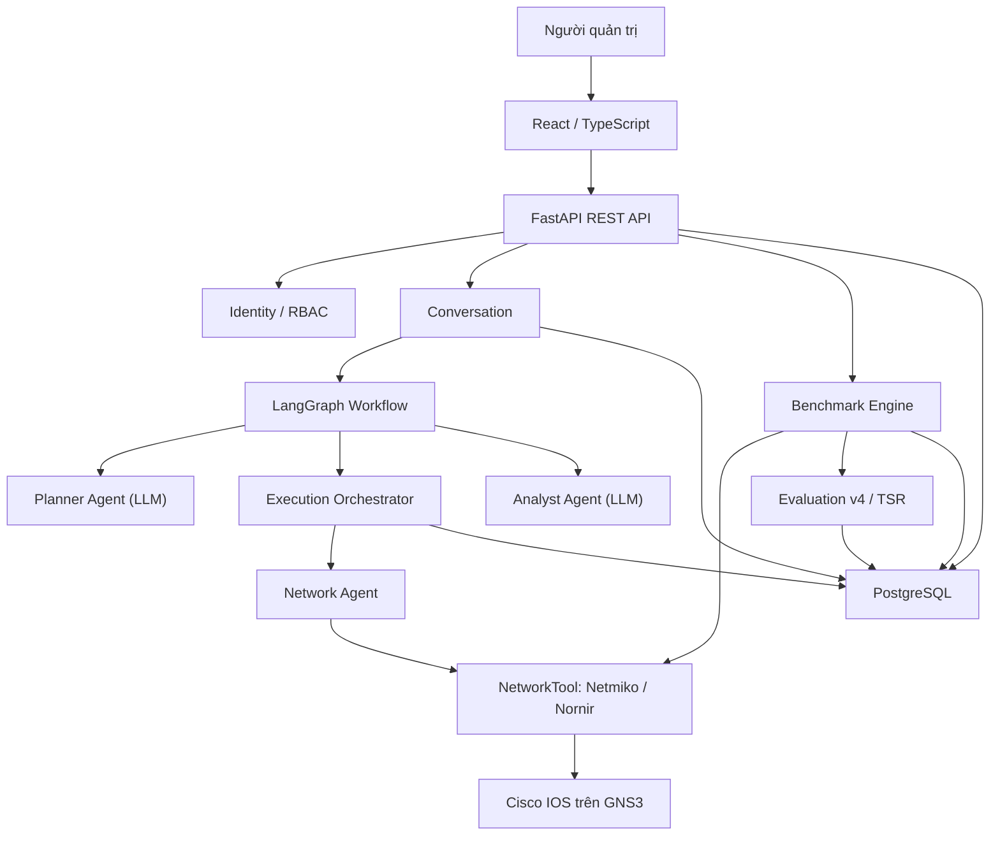

# BÁO CÁO CUỐI KỲ ĐỒ ÁN CHUYÊN NGÀNH

## NGHIÊN CỨU VÀ XÂY DỰNG HỆ THỐNG MULTI-AGENT HỖ TRỢ CẤU HÌNH VÀ XỬ LÝ SỰ CỐ MẠNG

**Trường:** Đại học Sài Gòn — Chuyên ngành Kỹ thuật máy tính  
**Nhóm sinh viên:** Phạm Đăng Minh Khang; Phạm Đình Duy Thái; Triệu Phú Quân  
**Phạm vi đối chiếu:** mã nguồn nhánh develop của backend và frontend, tài liệu đề cương giữa kỳ và bằng chứng kiểm thử cung cấp ngày 03/11/2026.

### Tóm tắt

Đề tài nghiên cứu, thiết kế và hiện thực nguyên mẫu hệ thống Multi-Agent hỗ trợ quản trị viên thực hiện tác vụ cấu hình, kiểm tra và chẩn đoán sự cố mạng thông qua ngôn ngữ tự nhiên. Kiến trúc gồm Planner Agent sử dụng LLM để xây dựng kế hoạch có cấu trúc; Network Agent thực thi lệnh qua một giao diện công cụ mạng; Analyst Agent phân tích bằng chứng, sinh nhận định tiếng Việt và xuất dự đoán nguyên nhân dạng dữ liệu. Các Orchestrator và LangGraph quản lý luồng nghiệp vụ, quan hệ phụ thuộc, trạng thái thực thi và điểm tạm dừng phê duyệt. Phần mềm xây dựng trên FastAPI, Python, PostgreSQL, React, TypeScript; sử dụng NVIDIA AI endpoint, Netmiko/Nornir và môi trường mạng GNS3.

Ngoài các phân hệ quản lý thiết bị, credential, người dùng, vai trò, hội thoại, tác vụ và audit, hệ thống đã triển khai một **Benchmark Engine** có kịch bản tiêm lỗi, kiểm tra điều kiện trước/sau, Ground Truth, cleanup và lịch sử lần chạy. Evaluator phiên bản **db-benchmark-v4** tham khảo cơ chế của NIKA 0.2: so sánh tập hợp cặp (tài nguyên, loại lỗi) do Analyst dự đoán với Ground Truth, tính Precision, Recall, F1 cho RCA, Localization và Fault Type, đồng thời ghi nhận Detection, GOAL, Task Success Rate, thời gian hoạt động workflow AI và số lượt gọi công cụ. Các số đo và bằng chứng được lưu trong PostgreSQL và hiển thị trên giao diện Evaluations.

Kết quả kiểm chứng có thể xác nhận tại thời điểm lập báo cáo gồm Docker build và khởi động API thành công; **42/42 bài test được chọn đạt, kèm một cảnh báo Pydantic**; và một lượt benchmark chẩn đoán thực tế hiển thị GOAL/RCA PASS, các chỉ số chấm theo nhãn cấu trúc đạt 100%, thời gian workflow AI **22,40 giây** cùng **4 lượt Agent→Tool**. Đây là bằng chứng của một lượt chạy, **không đại diện cho độ chính xác tổng thể, hiệu năng trung bình hay độ an toàn trên nhiều kịch bản**. Hai tiêu chí Remediation và Safety chưa có bộ chấm kết quả độc lập, nên được ghi NOT_APPLICABLE. Hệ thống cũng chưa phải closed-loop self-healing hay bộ triển khai đầy đủ của NIKA.

**Từ khóa:** Multi-Agent System, Large Language Model, LangGraph, Network Automation, Network Troubleshooting, Root Cause Analysis, NIKA, Ground Truth, Human-in-the-loop, GNS3.

---

# CHƯƠNG 1. GIỚI THIỆU VẤN ĐỀ VÀ TỔNG QUAN TÌNH HÌNH NGHIÊN CỨU

## 1.1. Bài toán quản trị và tự động hóa mạng

Hạ tầng mạng hiện đại thường bao gồm nhiều loại thiết bị, phiên bản hệ điều hành, giao thức và miền quản trị. Một thay đổi tưởng như cục bộ, chẳng hạn cập nhật địa chỉ IP, chính sách định tuyến hoặc VLAN, có thể ảnh hưởng đến nhiều thành phần phụ thuộc. Quản trị thủ công bằng giao diện dòng lệnh đòi hỏi người vận hành phải nhớ cú pháp theo nhà cung cấp, xác định đúng thứ tự thao tác, kiểm tra trạng thái trước và sau thay đổi, đồng thời lưu lại bằng chứng phục vụ truy vết. Khi quy mô tăng, phương pháp này phát sinh ba nhóm vấn đề chính: chi phí vận hành cao, kết quả thiếu đồng nhất và rủi ro sai sót do con người.

Tự động hóa mạng chuyển các thao tác lặp lại thành quy trình có thể lập trình. Tuy nhiên, tự động hóa không chỉ là gửi một tập lệnh tới nhiều thiết bị. Một hệ thống phù hợp cần quản lý inventory, thông tin xác thực, quan hệ phụ thuộc giữa các bước, trạng thái từng thiết bị, cơ chế xử lý lỗi, kiểm tra kết quả và nhật ký kiểm toán. Đối với thao tác làm thay đổi cấu hình, hệ thống còn phải bảo đảm đúng đối tượng, đúng nội dung đã được phê duyệt và không thực thi khi điều kiện an toàn chưa thỏa mãn.

RFC 8969 mô tả tự động hóa quản lý dịch vụ và mạng như một vòng đời gồm tạo lập, cung cấp, giám sát, chẩn đoán, bảo đảm và tối ưu dịch vụ; các mô hình dữ liệu đóng vai trò liên kết trạng thái mong muốn với trạng thái vận hành [2]. Cách nhìn theo vòng đời cho thấy một giải pháp tự động hóa hoàn chỉnh phải vượt ra ngoài việc sinh lệnh: nó cần có khả năng kiểm tra, quan sát và phản hồi.

## 1.2. Ứng dụng AI và LLM trong quản trị mạng

Mô hình ngôn ngữ lớn (Large Language Model — LLM) cung cấp một lớp giao tiếp ngữ nghĩa giữa ý định của người vận hành và các thao tác kỹ thuật. Thay vì yêu cầu người dùng chỉ định toàn bộ câu lệnh, LLM có thể phân loại nhiệm vụ, tách yêu cầu thành các bước, lựa chọn dữ liệu cần thu thập và diễn giải kết quả. Trong quản trị mạng, khả năng này đặc biệt hữu ích vì yêu cầu thường được mô tả ở mức mục tiêu, trong khi thực thi cần biểu diễn cụ thể theo thiết bị và giao thức.

Tuy nhiên, đầu ra của LLM có tính xác suất và có thể chứa thiết bị không tồn tại, cú pháp không hợp lệ hoặc suy luận thiếu bằng chứng. Vì vậy, LLM không nên được xem là nguồn chân lý duy nhất và không nên trực tiếp nắm giữ thông tin xác thực hay quyền thay đổi cấu hình. Kiến trúc an toàn cần đặt LLM sau các ranh giới kiểm soát: cung cấp inventory giới hạn, buộc đầu ra theo schema, kiểm tra lại định danh, phân biệt quyền đọc/ghi, phê duyệt thao tác rủi ro và lưu toàn bộ dấu vết thực thi.

Mô hình ReAct cho thấy việc xen kẽ suy luận và hành động giúp mô hình cập nhật kế hoạch dựa trên quan sát từ môi trường [4]. Dù đề tài không cài đặt ReAct theo đúng thuật toán của công trình này, nguyên tắc tách bước lập kế hoạch, hành động và quan sát là cơ sở hữu ích để thiết kế quy trình tác tử có thể kiểm soát.

## 1.3. Các nghiên cứu về cấu hình mạng tự động

Các nghiên cứu gần đây tập trung vào việc chuyển chính sách hoặc yêu cầu ngôn ngữ tự nhiên thành cấu hình mức thấp. NETBUDDY sử dụng LLM để biến yêu cầu cấp cao thành cấu hình P4 và BGP, đồng thời chia quá trình sinh cấu hình thành các bước nhỏ và sử dụng cơ chế tự sửa nhằm cải thiện kết quả [6]. LLM-NetCFG đề xuất các tác tử cấu hình trong định hướng Zero-touch Network and Service Management, kết hợp sinh, xác minh và triển khai cấu hình từ intent ngôn ngữ tự nhiên [7]. Một hướng khác sử dụng các LLM Agent để dịch cấu hình giữa các nền tảng nhà cung cấp, kết hợp phân rã cấu hình theo intent và xác minh hai giai đoạn về cú pháp và ngữ nghĩa [8].

Các công trình này cho thấy ba xu hướng. Thứ nhất, yêu cầu cấp cao cần được phân rã thành đơn vị nhỏ để giảm độ phức tạp của từng lần sinh. Thứ hai, kết quả sinh bởi LLM cần qua lớp xác minh độc lập. Thứ ba, đánh giá phải xem xét cả tính đúng cú pháp và tính đúng ngữ nghĩa; một cấu hình được thiết bị chấp nhận chưa chắc đã đạt mục tiêu vận hành.

Đề tài kế thừa tư tưởng phân rã bằng cách biểu diễn yêu cầu thành các operation có thứ tự và dependency. Tuy nhiên, phiên bản hiện tại chưa có bộ kiểm tra cú pháp theo nền tảng, mô phỏng cấu hình trước khi áp dụng hoặc xác minh hình thức đối với trạng thái đích. Do đó, phạm vi hiện tại là nguyên mẫu có kiểm soát, chưa phải hệ thống cấu hình tự trị hoàn toàn.

## 1.4. Các nghiên cứu về network troubleshooting

Network troubleshooting là quá trình phát hiện triệu chứng, thu thập dữ liệu liên quan, khoanh vùng miền lỗi, suy luận nguyên nhân gốc và đề xuất hoặc thực hiện biện pháp khắc phục. Phương pháp truyền thống dựa trên runbook, luật chuyên gia, so sánh cấu hình và tương quan sự kiện. Trong hệ thống lớn, dữ liệu có thể đến từ log, trạng thái giao thức, bảng định tuyến, chỉ số hiệu năng và topology; vì vậy, thách thức cốt lõi là liên kết bằng chứng phân tán với quan hệ phụ thuộc giữa các dịch vụ và thiết bị.

RFC 9232 mô tả mức trưởng thành của telemetry từ thu thập dữ liệu tới vòng điều khiển khép kín, trong đó hệ thống thông minh tự động yêu cầu dữ liệu, phân tích và cập nhật hoạt động mạng [9]. Các nghiên cứu LLM cho Root Cause Analysis gần đây nhấn mạnh rằng LLM thuần túy dễ tạo suy luận không ổn định; kết quả cần được ràng buộc bởi bằng chứng có cấu trúc và tri thức miền [10].

Trong đề tài, Planner Agent tạo các bước thu thập bằng lệnh quan sát, Network Agent lấy kết quả thực tế và Analyst Agent tổng hợp phát hiện, nguyên nhân có khả năng cùng khuyến nghị. Đặc biệt, nhóm đã bổ sung các kịch bản sự cố GNS3 có Ground Truth và bộ chấm phiên bản v4 dựa trên cặp tài nguyên–loại lỗi, tham khảo NIKA [14, 15]. Việc chấm có cấu trúc giúp tách đánh giá đúng vị trí khỏi đúng loại nguyên nhân và tránh việc câu trả lời chỉ chứa đủ từ khóa vẫn được tính đúng. Tuy nhiên, đây là đánh giá đối chiếu nhãn kịch bản, không phải tự động kiểm chứng lại tính đúng đắn của mọi nhận định từ trạng thái mạng; telemetry liên tục và knowledge graph chưa được triển khai.

## 1.5. Multi-Agent trong quản trị và xử lý sự cố hệ thống

Multi-Agent System (MAS) phân chia một nhiệm vụ phức tạp cho nhiều tác tử có vai trò và giao diện rõ ràng. Trong ứng dụng LLM, AutoGen minh họa khả năng tổ chức các tác tử hội thoại để phối hợp hoàn thành nhiệm vụ [5]. Lợi ích của cách tiếp cận nhiều tác tử không nằm ở số lượng tác tử, mà ở khả năng cô lập trách nhiệm và quyền hạn: tác tử lập kế hoạch không cần quyền truy cập credential; tác tử thực thi không cần tự suy luận mục tiêu; tác tử phân tích không được tự thay đổi thiết bị.

Đối với quản trị mạng, phân tách này giúp giảm phạm vi ảnh hưởng khi một thành phần trả kết quả sai. Planner tạo kế hoạch nhưng không kết nối thiết bị. Network Agent chỉ nhận operation và mapping đã được kiểm tra. Analyst chỉ xử lý output sau thực thi. Orchestrator, thay vì LLM, quản lý trạng thái, dependency, phê duyệt và ghi audit. Đây là mô hình “AI đề xuất — phần mềm xác minh và thực thi” phù hợp hơn với yêu cầu kiểm soát thay đổi.

## 1.6. Nhận xét các nghiên cứu liên quan

| Hướng nghiên cứu | Đóng góp chính | Hạn chế cần lưu ý khi áp dụng |
| --- | --- | --- |
| Intent-Based Networking | Trừu tượng hóa mục tiêu khỏi chi tiết thiết bị; nhấn mạnh fulfillment và assurance | Cần mô hình intent, cơ chế dịch và vòng phản hồi đáng tin cậy |
| LLM sinh cấu hình | Giảm rào cản cú pháp; hỗ trợ biến yêu cầu tự nhiên thành cấu hình | Có nguy cơ hallucination, sai cú pháp hoặc đúng cú pháp nhưng sai mục tiêu |
| LLM hỗ trợ troubleshooting | Tổng hợp nhiều bằng chứng và tạo giải thích dễ hiểu | Cần grounding, telemetry và benchmark RCA; không nên suy luận khi thiếu dữ liệu |
| Multi-Agent | Phân tách trách nhiệm, chuyên môn và quyền hạn | Tăng độ phức tạp điều phối, trạng thái và xử lý lỗi liên tác tử |
| Closed-loop automation | Theo dõi trạng thái thực tế và hiệu chỉnh để duy trì intent | Đòi hỏi quan sát liên tục, kiểm tra hậu điều kiện, rollback và quản trị rủi ro |

Nhìn chung, các nghiên cứu khẳng định tiềm năng của LLM trong giao diện intent và lập kế hoạch, nhưng cũng thống nhất gián tiếp về nhu cầu xác minh ngoài mô hình. Khoảng cách lớn giữa nguyên mẫu và triển khai thực tế nằm ở dữ liệu đánh giá, kiểm soát tác động, khả năng phục hồi và chứng minh rằng trạng thái sau thực thi phù hợp với mục tiêu ban đầu.

## 1.7. Khoảng trống nghiên cứu và hướng tiếp cận của đề tài

Khoảng trống mà đề tài hướng tới là xây dựng một luồng end-to-end có thể truy vết cho yêu cầu quản trị mạng bằng tiếng Việt, đồng thời hạn chế quyền tự quyết trực tiếp của LLM. Hướng tiếp cận gồm các đặc điểm:

1. Tiếp nhận yêu cầu trong hội thoại và gắn yêu cầu gốc với Task để truy vết.
2. Chỉ cung cấp cho Planner danh sách thiết bị tồn tại trong inventory và kiểm tra lại mọi `device_id` do mô hình trả về.
3. Biểu diễn kế hoạch thành các operation có thứ tự, dependency, vai trò thiết bị và chế độ truy cập `READ`/`WRITE`.
4. Tách Planner Agent, Network Agent và Analyst Agent; đặt lifecycle và business rule trong Orchestrator cùng domain service.
5. Yêu cầu phê duyệt thao tác `WRITE`; đối chiếu snapshot câu lệnh và SHA-256 hash trước khi thực thi.
6. Mã hóa credential thiết bị trong PostgreSQL và chỉ giải mã theo nhu cầu tại ranh giới kết nối.
7. Lưu trạng thái Task, operation, mapping thiết bị, execution, action log và activity timeline.

Đề tài còn triển khai bộ thực nghiệm có thể tái lập với kịch bản tiêm lỗi, Ground Truth, đánh giá định lượng và lịch sử Benchmark Run. Đây là mở rộng đã hiện thực so với đề cương ban đầu; tuy nhiên **chưa đồng nghĩa với việc sử dụng benchmark chính thức của NIKA**. Intent assurance liên tục, rollback tự động, telemetry thời gian thực và kiểm chứng trên mạng production vẫn nằm ngoài phạm vi.

---

# CHƯƠNG 2. CƠ SỞ LÝ THUYẾT VÀ CÔNG NGHỆ

## 2.1. Large Language Model

LLM là mô hình học sâu được huấn luyện trên tập dữ liệu văn bản lớn để ước lượng phân bố xác suất của token tiếp theo. Nhờ học các mẫu ngôn ngữ và biểu diễn ngữ nghĩa, LLM có thể thực hiện nhiều tác vụ như phân loại ý định, trích xuất thực thể, sinh nội dung có cấu trúc và tổng hợp thông tin. Trong đề tài, LLM không được huấn luyện lại mà được truy cập qua NVIDIA API bằng `ChatNVIDIA`.

Hai tác vụ sử dụng LLM là lập kế hoạch và phân tích kết quả. Planner nhận yêu cầu, public inventory và JSON Schema của `ExecutionPlanCreate`; đầu ra được Pydantic kiểm tra. Khi JSON không hợp lệ, tác tử cung cấp lỗi validation để mô hình sửa, tối đa hai lần thử lại; lời gọi có timeout 90 giây. Analyst nhận danh sách kết quả thực thi đã cấu trúc và trả về các trường diễn giải: `summary`, `findings`, `likely_causes`, `recommendations`, `requires_more_data`; đồng thời xuất `is_anomaly` và danh sách `root_causes` có cấu trúc (device, interface, fault_type) để phục vụ chấm RCA.

Các tham số được đặt theo hướng giảm biến thiên: `temperature=0` và tắt chế độ suy luận mở rộng của model trong adapter hiện dùng. Dù vậy, tính xác định tuyệt đối không được bảo đảm. Schema validation chỉ chứng minh đúng cấu trúc, không chứng minh lệnh mạng đúng ngữ nghĩa. Vì vậy, đầu ra LLM tiếp tục phải chịu kiểm tra inventory, dependency, access mode và approval.

## 2.2. AI Agent và Multi-Agent System

AI Agent là thành phần nhận quan sát, lựa chọn hành động và tạo kết quả nhằm đạt mục tiêu trong một môi trường. Một agent thực dụng thường gồm mô hình ra quyết định, trạng thái hoặc ngữ cảnh, công cụ tương tác và cơ chế phản hồi. MAS là tập hợp nhiều agent phối hợp thông qua giao diện hoặc giao thức chung.

Trong đề tài, khái niệm “agent” được sử dụng theo vai trò ứng dụng:

- **Planner Agent:** dùng LLM để tạo execution plan có cấu trúc.
- **Network Agent:** không dùng LLM; kiểm tra tham số và gọi Network Tool.
- **Analyst Agent:** dùng LLM để phân tích output và tạo phản hồi tiếng Việt.

LangGraph phụ trách chuyển bước cấp cao; ba handler planning, execution và analysis thực hiện quy tắc của từng node. Các handler không được xem là tác tử LLM mà là thành phần phần mềm tất định. Thiết kế này tránh dùng một “siêu tác tử” vừa suy luận, giữ credential, thực thi và tự xác nhận kết quả.

## 2.3. Intent-Based Networking

RFC 9315 định nghĩa intent là tập mục tiêu vận hành và kết quả mong muốn được mô tả theo cách khai báo, không chỉ định cách đạt được [1]. IBN bao gồm hai nhóm chức năng: intent fulfillment chuyển intent thành hành động; intent assurance quan sát và xác nhận mạng tiếp tục tuân thủ intent.

Đề tài hỗ trợ một phần của intent fulfillment: người dùng nhập yêu cầu tiếng Việt, Planner biến yêu cầu thành operation và command, sau đó Orchestrator thực thi theo điều kiện. Tuy nhiên, không phải mọi câu lệnh ngôn ngữ tự nhiên đều là intent đúng nghĩa. Yêu cầu “chạy `show ip route` trên P1” là chỉ thị thao tác cụ thể, còn yêu cầu “duy trì kết nối giữa hai site khi một đường truyền lỗi” gần với intent vì mô tả kết quả mong muốn. Phiên bản hiện tại chưa có mô hình trạng thái mong muốn bền vững, phát hiện intent drift hoặc vòng assurance liên tục; do đó hệ thống chỉ mới tiếp cận IBN ở lớp giao diện và phân rã yêu cầu.

## 2.4. Network Automation

Network Automation là việc sử dụng phần mềm để thực hiện có kiểm soát các tác vụ cấu hình, kiểm tra, giám sát và quản lý vòng đời mạng. Các thành phần cơ bản gồm inventory, credential management, driver kết nối, task runner, orchestration, validation và audit.

Trong hệ thống, inventory được lưu ở PostgreSQL; thiết bị liên kết với brand, category và credential. Network Tool sử dụng `device_type` để chọn driver Netmiko. Operation được thực thi theo `display_order` và dependency `ON_SUCCESS` hoặc `ON_COMPLETION`. Lệnh đọc dùng `send_command`; lệnh ghi dùng `send_config_set`. Kết quả được lưu ở mức mapping thiết bị, lần thực thi và action log.

## 2.5. Network Troubleshooting và Root Cause Analysis

Troubleshooting là quy trình giảm dần không gian giả thuyết thông qua quan sát và kiểm tra. Root Cause Analysis (RCA) đi xa hơn việc xác định triệu chứng: mục tiêu là tìm nguyên nhân nền tảng có khả năng giải thích chuỗi sự kiện. Một quy trình RCA đáng tin cậy phải phân biệt dữ kiện quan sát, giả thuyết và kết luận; đồng thời nêu bằng chứng phản chứng hoặc mức độ thiếu dữ liệu.

Analyst Agent của đề tài được prompt để giữ nguyên hostname, địa chỉ IP, interface và mã lỗi; phân biệt dữ kiện với suy luận; không khẳng định nguyên nhân nếu thiếu bằng chứng. Phần diễn giải `likely_causes` vẫn là nhận định dựa trên bằng chứng; song evaluator v4 đã có đối chiếu một kết luận cấu trúc độc lập của Agent với Ground Truth và cung cấp Precision/Recall/F1. Chưa có cơ chế tự hiệu chuẩn xác suất tin cậy, kho tri thức RCA chuyên dụng hoặc xác minh nhân quả bằng can thiệp độc lập; không nên đồng nhất điểm trên scenario với một chứng minh nguyên nhân trong mọi hệ thống mạng.

## 2.6. Các phương pháp kiểm tra và kiểm soát thực thi cấu hình

Kiểm soát cấu hình nên được áp dụng theo nhiều lớp:

1. **Kiểm tra đầu vào:** xác thực người dùng, phân quyền RBAC và kiểm tra schema.
2. **Giới hạn phạm vi:** chỉ cho Planner sử dụng thiết bị từ inventory; `SOURCE` và `CONTEXT` chỉ được `READ`.
3. **Kiểm tra kế hoạch:** dependency chỉ tham chiếu operation đứng trước; không cho phép device trùng trong một operation; operation có device phải có command.
4. **Kiểm tra trước thực thi:** thao tác `WRITE` phải có approval; câu lệnh thực tế phải khớp `commands_snapshot` và `request_hash` đã phê duyệt.
5. **Kiểm tra bởi thiết bị hoặc giao thức:** NETCONF định nghĩa khả năng `validate`, `test-only` và confirmed commit để giảm rủi ro trước khi áp dụng [3]. Phiên bản hiện tại của đề tài sử dụng CLI qua Netmiko/Nornir nên chưa có các bảo đảm giao dịch này.
6. **Kiểm tra hậu điều kiện:** chạy lệnh xác minh sau thay đổi và so sánh trạng thái thực tế với mục tiêu. Planner được hướng dẫn tách bước xác minh, nhưng hệ thống chưa có bộ kiểm chứng ngữ nghĩa độc lập bắt buộc cho mọi cấu hình.
7. **Khôi phục:** tạo checkpoint, rollback hoặc cấu hình ngược khi xác minh thất bại. Cơ chế này chưa được triển khai.

Ngoài ra, credential được mã hóa đối xứng bằng `pgcrypto` với AES-256. Public API chỉ trả metadata; password và enable secret chỉ được giải mã trong bộ nhớ khi chuẩn bị kết nối. Agent LLM không nhận khóa mã hóa hoặc credential.

## 2.7. LangGraph

LangGraph là thư viện xây dựng workflow tác tử theo mô hình đồ thị trạng thái. Mỗi node thực hiện một bước xử lý và trả phần state cần cập nhật; edge quy định thứ tự chuyển bước. Trong đề tài, LangGraph sở hữu luồng cấp cao `check_gns3 → plan → execute → analyze`.

Hệ thống biên dịch hai graph. Graph message mới thực hiện đầy đủ bốn bước; graph approval đi vào `execute → analyze` sau khi khôi phục Task bằng `operation_device_id`. Cách tách điểm vào phù hợp với đặc tính chờ phê duyệt kéo dài. Graph không sử dụng checkpointer làm nguồn trạng thái nghiệp vụ độc lập: Task, Operation, mapping, Approval và audit vẫn được lưu bởi domain service trong PostgreSQL. Thiết kế này tránh sai lệch giữa checkpoint và trạng thái đã được phê duyệt.

## 2.8. Netmiko và Nornir

**Netmiko** là thư viện Python chuẩn hóa việc kết nối CLI tới thiết bị mạng đa nhà cung cấp. API cung cấp các phương thức như `send_command` cho lệnh quan sát và `send_config_set` cho tập lệnh cấu hình [11]. Backend `NetmikoNetworkTool` của đề tài mở kết nối theo device config, thực thi tuần tự và luôn gọi `disconnect()` trong khối `finally`.

**Nornir** là framework tự động hóa thuần Python có inventory, task và runner dạng plugin. `ThreadedRunner` cho phép thực thi task trên nhiều host bằng nhóm luồng [12]. Trong đề tài, `NornirNetworkTool` tạo inventory động trong bộ nhớ từ PostgreSQL và sử dụng plugin `nornir-netmiko`; không tạo tệp YAML chứa secret. Backend được lựa chọn bằng biến `NETWORK_BACKEND`. Tuy nhiên, Orchestrator hiện duyệt mapping thiết bị tuần tự, và mỗi lần gọi tool chỉ tạo inventory cho một thiết bị; vì vậy lợi ích song song hóa nhiều thiết bị của Nornir chưa được khai thác đầy đủ.

## 2.9. GNS3 và GNS3 API

GNS3 là nền tảng mô phỏng/emulation mạng cho phép xây dựng topology gồm router, switch, máy ảo và các liên kết. Kiến trúc GNS3 có controller quản lý project, compute và cung cấp REST API cho backend [13]. Đây là môi trường phù hợp để kiểm thử thay đổi mạng mà không tác động hạ tầng sản xuất.

Trong đề tài, các node Cisco IOS trong GNS3 được tiếp cận qua các cổng console/Telnet được ánh xạ tới máy host. Cấu hình có `GNS3_IP`, `GNS3_PORT` và `GNS3_PROJECT_ID`. Tuy nhiên, provider hiện chỉ gọi `GET /v2/version` để xác nhận GNS3 Server khả dụng trước khi chạy workflow. Hệ thống chưa sử dụng API để đọc node/link, mở project, bật/tắt node hoặc đồng bộ topology. Inventory vận hành hiện được quản lý trong PostgreSQL.

---

# CHƯƠNG 3. PHÂN TÍCH, THIẾT KẾ VÀ XÂY DỰNG HỆ THỐNG

## 3.1. Phân tích yêu cầu hệ thống

### 3.1.1. Yêu cầu chức năng

Căn cứ nhiệm vụ trong đề cương giữa kỳ, nhóm cụ thể hóa hệ thống thành các chức năng đã có mã nguồn: (1) xác thực người dùng, quản lý phiên đăng nhập và phân quyền; (2) quản lý brand, category, device và credential thiết bị; (3) tạo, đặt tên, xem lại hội thoại; (4) tiếp nhận yêu cầu tiếng Việt và tạo Task; (5) lập kế hoạch gồm các operation cùng quan hệ phụ thuộc; (6) thực thi lệnh READ và hỗ trợ thực thi WRITE sau phê duyệt; (7) ghi nhận trạng thái, activity event, task execution và device action log; (8) Analyst tổng hợp phân tích và phản hồi; (9) quản lý Benchmark Scenario, tiêm lỗi GNS3, cleanup, lưu Run; (10) đánh giá tự động GOAL/RCA, thời gian và lượt tương tác; (11) tra cứu Audit Log cùng bộ lọc và phân trang; (12) giao diện web theo các module quản trị.

Đối tượng sử dụng là người quản trị hệ thống, người quản trị mạng có quyền thực thi/phê duyệt và người được cấp quyền xem thông tin. Quyền được gán dựa trên cặp chức năng quản lý – hành động, không chỉ kiểm tra đăng nhập. Dữ liệu nhạy cảm như password thiết bị, token và Ground Truth benchmark không được truyền tùy tiện tới Agent hay các API công khai.

### 3.1.2. Yêu cầu phi chức năng

| Nhóm yêu cầu | Phương án đã hiện thực | Phạm vi chưa bảo đảm |
| --- | --- | --- |
| Tính toàn vẹn | Pydantic schema; kiểm tra device ID; ràng buộc operation/dependency; transaction lưu kế hoạch và một số thao tác nghiệp vụ | Không phải mọi thao tác CLI trên nhiều thiết bị đều có rollback giao dịch |
| An toàn | RBAC; mã hóa credential; Approval Gate; đối chiếu snapshot/hash trước WRITE | Chưa có bộ chấm Safety định lượng và chính sách chặn mọi lệnh nguy hiểm ở mức vendor |
| Truy vết | Task, Operation, Mapping, Activity Event, Task Execution, Device Action Log, Audit Log | Chưa có hệ thống phân tích sự kiện bảo mật độc lập |
| Khả năng bảo trì | Module hóa backend theo domain; router/service/repository/provider; hợp đồng Agent/NetworkTool | Chưa có CI xác minh toàn bộ lab tự động |
| Khả năng kiểm thử | Unit test cho Agent, service, approval, benchmark, scorer và schema; Benchmark Engine có Ground Truth | Chưa có ma trận kết quả thống kê lớn và kiểm thử trên production |
| Tính mở rộng | Hỗ trợ Netmiko/Nornir và có cơ chế tách nhà cung cấp LLM qua adapter | Multi-device concurrency và fault tolerance đa node chưa được đánh giá đầy đủ |

### 3.1.3. Phạm vi và tác nhân

Hệ thống chạy trong phòng lab GNS3; không thao tác trên thiết bị production. Người dùng cuối tiếp xúc với giao diện quản trị; Agent được gọi gián tiếp qua service và workflow, không truy cập trực tiếp secret hoặc ORM. Planner chỉ nhìn inventory công khai; Network Agent nhận lệnh cụ thể đã được xác nhận; Analyst chỉ đọc kết quả lệnh. Riêng Benchmark Engine được phép tiêm lỗi và hoàn nguyên theo kịch bản để tổ chức thực nghiệm: đây là thao tác của hạ tầng kiểm thử, không phải hành động khắc phục do Agent tự quyết định.

## 3.2. Kiến trúc tổng thể hệ thống

Ứng dụng theo kiến trúc client–server gồm React/TypeScript ở lớp trình bày, FastAPI ở lớp HTTP, các domain nghiệp vụ trong backend, lớp Agent orchestration, PostgreSQL và các provider giao tiếp thiết bị. Những domain đang có gồm Identity, Inventory, Conversation, Execution, Evaluation, Benchmark và Audit. Các lớp router chủ yếu nhận dữ liệu, xác thực và gọi service; repository quản lý truy cập SQLAlchemy/PostgreSQL; provider phụ trách hệ thống bên ngoài.

**Phân tách nguồn sự thật:** LangGraph giữ dữ liệu chuyển tiếp giữa các node; trạng thái nghiệp vụ dài hạn của Task, Operation, Approval, Conversation và Benchmark được lưu ở PostgreSQL. Khôi phục sau phê duyệt dựa trên bản ghi đã lưu, thay vì phụ thuộc vào một checkpoint in-memory của LangGraph.

**Ranh giới GNS3:** GNS3 Provider hiện kiểm tra khả dụng server bằng endpoint version; topology vật lý được cấu hình tại GNS3. Thực thi CLI thực tế thông qua console/đầu nối thiết bị được lưu trong Inventory; chưa có module đồng bộ toàn bộ graph node–link từ REST API GNS3.

## 3.3. Thiết kế kiến trúc Multi-Agent

| Tác tử/thành phần | Đầu vào | Chức năng | Đầu ra và giới hạn |
| --- | --- | --- | --- |
| Planner Agent | Yêu cầu tiếng Việt, danh sách thiết bị được phép, JSON Schema | Phân rã yêu cầu thành kế hoạch; chọn operation, mapping, dependency và READ/WRITE | ExecutionPlanCreate; không giải mã credential, không chạy CLI |
| Network Agent | Operation và danh sách command cho mapping | Kiểm tra input và gọi NetworkTool qua adapter | NetworkExecutionResult; không dùng LLM, không tự chọn mạng đích |
| Analyst Agent | Command outputs, hostname, trạng thái thực thi | Tóm tắt phát hiện, giả thuyết, khuyến nghị; tạo kết luận RCA dạng JSON | AnalysisResult; không kết nối hay sửa thiết bị |
| Planning Orchestrator | Message/Conversation | Gọi Planner, kiểm tra device ID, lưu kế hoạch | Task/plan đã xác thực |
| Execution Orchestrator | Task và graph operation | Kiểm tra dependency, Approval Gate, thực thi và cập nhật trạng thái | Execution/result/action logs |
| Analysis Orchestrator | Kết quả thực thi | Lưu kết luận có cấu trúc vào timeline và tạo FINAL_RESPONSE | Message cuối cùng cùng dấu vết phân tích |

Hệ thống là kiến trúc **đa tác tử có điều phối tập trung**, không phải các LLM tự hội thoại tự do. Network Agent không sử dụng mô hình ngôn ngữ, nhưng là tác tử chuyên trách thực thi trong pipeline. Planner và Analyst gọi mô hình qua NVIDIA AI endpoint với JSON output được Pydantic kiểm tra; có cơ chế thử lại khi phản hồi không hợp lệ. Analyst được hướng dẫn giữ nguyên hostname, interface, mã lỗi và phân biệt dữ kiện với suy luận.

Với phiên bản đánh giá mới, Analyst trả thêm `is_anomaly` và `root_causes` gồm `device`, `interface` (có thể null) và `fault_type`. Dữ liệu đó do Agent tạo dựa trên output quan sát, **không phải do evaluator trích ngược từ Ground Truth hoặc tìm từ khóa trong văn bản**. Nếu Agent không thể tạo JSON hợp lệ, Analysis Orchestrator sử dụng phản hồi dự phòng để bảo toàn trải nghiệm hội thoại nhưng bộ chấm không coi phản hồi dự phòng là kết luận RCA hợp lệ.

## 3.4. Vai trò và cơ chế điều phối giữa các Agent

LangGraph sử dụng graph chính `check_gns3 → plan → execute → analyze → END` và graph tiếp tục sau approval `execute → analyze → END`. Workflow đầu tiên được kích hoạt từ một USER_REQUEST. Planning node tạo Task và sơ đồ operations. Execution node duyệt kế hoạch và gọi Network Agent. Analysis node chỉ tạo phản hồi cuối khi Task ở trạng thái phù hợp; khi vẫn chờ phê duyệt, nó phát thông báo APPROVAL_REQUEST.

Kế hoạch thực thi gồm các bản ghi Task, TaskOperation, OperationDependency và TaskOperationDevice. Operation có thứ tự hiển thị, tham số command và phân loại chế độ đọc/ghi. Dependency hỗ trợ điều kiện `ON_SUCCESS` và `ON_COMPLETION`; Planner chỉ được tham chiếu operation đứng trước để không tạo chu trình. Execution Orchestrator đọc lại state từ DB, xử lý mapping hợp lệ, bỏ qua thao tác đã hoàn tất và cập nhật trạng thái theo kết quả.

Một approval có thể làm quy trình tạm dừng trong khoảng thời gian dài. Để tránh thực thi lại các lệnh đã xong, nhánh resume dùng Task và mapping đã lưu. Phần chờ quyết định của con người được ghi thành activity timeline và được loại trừ khỏi cách đo thời gian workflow AI mới.

## 3.5. Cơ chế quản lý thiết bị và topology

Inventory được chuẩn hóa thành các nguồn dữ liệu Brand, Category, Credential và Device. Thiết bị chứa hostname, host/port, loại driver và liên kết đến credential. Brand/Category phục vụ phân loại; service kiểm tra tham số kết nối và đối tượng liên quan. Có API quản lý kho thiết bị và giao diện thêm/sửa/xem danh sách.

Credential thiết bị độc lập với tài khoản đăng nhập hệ thống. Password và enable secret được mã hóa khi lưu bằng pgcrypto; khóa mã hóa đến từ biến môi trường, không được đưa vào git. Khi NetworkTool chuẩn bị kết nối, repository nội bộ mới giải mã theo nhu cầu, qua NetworkService/DeviceConnectionProvider. Pydantic response không đưa ciphertext hoặc plaintext ra API công khai. Mục tiêu của cách thiết kế này là ngăn LLM và frontend tiếp xúc với bí mật kết nối.

Topology liên kết mạng chưa có biểu diễn node–link đầy đủ trong DB. Điều này giới hạn các phép suy luận về đường đi hoặc fault propagation dựa trên topology. Topology thực nghiệm được cố định trong GNS3 và kịch bản chứa nhãn `topology`.

## 3.6. Quy trình tiếp nhận và phân tích yêu cầu

(1) Người dùng đăng nhập; Identity cấp access/refresh token và duy trì user session. (2) Frontend gửi message với Bearer token. (3) ConversationService lưu USER_REQUEST và Conversation nếu đây là tin đầu; ID người dùng lấy từ phiên xác thực. (4) API trả kết quả tạo message, workflow chạy ở background. (5) LangGraph kiểm tra GNS3, Planning Orchestrator tạo Task và gọi Planner. (6) Pydantic/ExecutionService kiểm tra kế hoạch và lưu một lần các operations, dependencies, device mappings. (7) Execution Orchestrator gọi Network Agent cho các mapping đủ điều kiện. (8) Analyst phân tích output, lưu Activity Event `ANALYSIS_COMPLETED` và tạo `FINAL_RESPONSE`. (9) Frontend lấy message và timeline để trình bày.

Đối với message tiếp theo trong hội thoại, endpoint tương ứng chỉ kích hoạt workflow cho người gửi USER; message AGENT không tự sinh Task. Conversation có tính năng tạo tiêu đề từ model, đổi tiêu đề và quản lý danh sách. Trạng thái được đọc qua các API theo Task để phục vụ giao diện tiến trình.

## 3.7. Quy trình chẩn đoán và khắc phục sự cố

Với tác vụ chẩn đoán, Planner thường tạo các operation READ như xem interface, bảng định tuyến, neighbor hoặc cấu hình liên quan. Network Agent thu thập output thực từ Cisco IOS qua Netmiko/Nornir. Analyst so sánh quan sát, mô tả tình trạng, nêu nguyên nhân khả dĩ và bước kiểm tra/khắc phục. Trong phiên bản v4, kết luận dạng cấu trúc được lưu độc lập với văn bản báo cáo để phục vụ Ground Truth evaluation.

Hệ thống có **khả năng thực thi cấu hình theo kế hoạch đã được tạo sẵn và được phê duyệt**; không đồng nghĩa Analyst tự quyết định thực hiện remediation. Chưa có vòng tự động tạo kế hoạch mới từ kết luận RCA, quy trình xác minh kết quả hậu sửa chữa cho mọi lệnh, rollback tự động hoặc closed-loop self-healing. Trong Benchmark Engine, `cleanup` là hành động khôi phục môi trường thử nghiệm theo kịch bản, không được tính là Agent đã khắc phục lỗi thành công.

## 3.8. Cơ chế kiểm tra, Human-in-the-loop và Audit Log

**Approval Gate** phân biệt READ có thể tiếp tục và WRITE phải xin phép. Lệnh WRITE chưa được duyệt làm mapping chuyển `WAITING_APPROVAL`; thao tác không kết nối thiết bị khi trạng thái PENDING. Phê duyệt lưu snapshot danh sách lệnh, request hash SHA-256 và metadata cần thiết. Khi tiếp tục, engine tính lại hash theo canonical JSON rồi so với snapshot; nếu lệnh khác đi, mapping bị đánh dấu FAILED mà không gửi lệnh. REJECTED hoặc EXPIRED cũng không được thực thi. Quyền quyết định thuộc người dùng có permission phù hợp; các quy tắc timeout và trạng thái được kiểm tra ở backend.

**Ba loại dấu vết cần phân biệt:** (i) `task_activity_events` ghi các mốc workflow/Agent/approval, (ii) `task_executions` ghi lần thực thi và thông tin gọi công cụ, (iii) `device_action_logs` ghi lệnh thực tế gửi tới thiết bị và output/status. Ngoài ra, domain Audit sở hữu `audit_logs` để truy vết các thao tác quản trị ở cấp hệ thống. Audit API hỗ trợ lọc actor, action, resource, trạng thái, khoảng thời gian và phân trang; có giao diện tra cứu/filter ngày ở frontend. Audit Log là append-only ở API, không cho client sửa/xóa. Các log không được chứa password, refresh token hoặc secret.

**Giới hạn:** cơ chế approval/hash là kiểm soát phạm vi thay đổi và tính toàn vẹn nội dung đã duyệt, không phải bằng chứng rằng mọi cấu hình được phê duyệt đều an toàn theo chính sách mạng. Chỉ số Safety trong Evaluation vẫn là NOT_APPLICABLE khi chưa có bộ kiểm chứng độc lập.

## 3.9. Thiết kế giao diện và triển khai hệ thống

Frontend được xây dựng bằng React 19, TypeScript, Vite, Tailwind CSS và hệ component shadcn; sử dụng các thư viện bảng, form, trạng thái và giao tiếp HTTP phù hợp. Các feature hiện có gồm Login/Profile, Dashboard, Chatbot/Conversation, Tasks, Devices, Credentials, Device Catalog, Users, Roles/Access Control, Audit Logs, Benchmark Scenarios, Benchmark Runs và Evaluations. Giao diện chat hỗ trợ danh sách hội thoại, activity timeline, hiển thị yêu cầu approval và mở chi tiết Task; trang Benchmark hỗ trợ nhập action/check/Ground Truth và xem kết quả chạy.

Trang Evaluations hiển thị lịch sử đánh giá, GOAL/RCA, Remediation/Safety, Latency và Interaction Turns, cùng các kết quả có cấu trúc của v4 gồm RCA F1, Precision, Recall, Localization F1, Fault Type F1 và Detection. Trang tổng quan TSR trình bày tỷ lệ, số mẫu hợp lệ và phân loại run. Phiên bản evaluator được hiển thị nhằm phân biệt cách chấm từ khóa cũ với bộ chấm v4.

Backend chạy trên FastAPI; PostgreSQL duy trì dữ liệu và pgcrypto; Docker Compose cấu hình api, db, migrate và pgAdmin. Giao diện frontend được phát triển độc lập và kết nối REST API cùng token. Một số module hiển thị/biểu đồ còn có mã dữ liệu mẫu ở repository, vì vậy không nên mặc nhiên khẳng định mọi thống kê trên mọi trang đều xuất phát từ dữ liệu production.

## 3.10. Phân hệ Benchmark và Evaluation đã triển khai

Benchmark Scenario có `scenario_key`, version, mô tả, topology, initial_message, preconditions, injection, fault_verification, ground_truth, evaluation_required_terms và cleanup. Engine thực hiện kiểm tra điều kiện trước; tiêm lỗi bằng các action có schema; xác minh trạng thái sự cố; sau đó phát hành run sẵn sàng để Chat của Agent giải quyết. Khi bắt đầu Chat, run liên kết tới conversation/source message; khi nhận FINAL_RESPONSE, lưu Evaluation và hoàn tất run. Cleanup khôi phục trạng thái môi trường sau thử nghiệm theo action được định nghĩa. Cơ chế này có thể quản lý scenario, lịch sử và trạng thái chuẩn bị/chạy/hoàn thành/thất bại/cleanup.

Các nhóm injection đã có bộ dựng command bao gồm shutdown/no shutdown interface, điều chỉnh network OSPF, MPLS trên interface, default route, IP/mask, ACL và BGP neighbor shutdown/no shutdown. Có các seed chứa các tình huống interface down, OSPF, MPLS, cấu hình IP, ACL, Loopback0 và BGP. Sự hiện diện của seed/chương trình dựng command **không mặc nhiên xác nhận đã chạy thành công tất cả scenario trong lab**.

Ground Truth được lưu ở snapshot của lần chạy để việc cập nhật scenario về sau không thay đổi căn cứ chấm của run cũ. `BenchmarkObservationRepository` đọc kết luận Agent từ Activity Event `ANALYSIS_COMPLETED`, đếm các lần Agent gọi tool và lấy mốc timestamp để tính thời gian. Evaluator v4 xuất dữ liệu từng metric với `expected_value`, `actual_value`, `evidence`; lưu vào các bảng Evaluation và metric, kết quả API chỉ đọc được người có quyền truy cập yêu cầu. TSR được tổng hợp bằng truy vấn SQL từ toàn bộ Benchmark Run, không lấy mẫu chỉ theo các dòng giao diện đã tải.

## 3.11. Thiết kế lưu trữ và quản lý phiên bản cơ sở dữ liệu

PostgreSQL dùng SQLAlchemy models và repositories cho các nhóm dữ liệu: identity/RBAC; device/credential; conversation/message; task/operation/dependency/mapping/approval; activity/execution/action logs; benchmark_scenarios/benchmark_runs; task_evaluations/task_evaluation_metrics; audit_logs. Các bảng liên hệ bằng ID để truy từ yêu cầu gốc đến Task, lệnh mạng và Evaluation.

Mã migration trong `migrations/versions/` có lịch sử từ 0001 đến 0007; runner quản lý checksum, transaction và advisory lock. Vì schema khởi tạo của một số môi trường đã có các đối tượng từ migration về sau, repository cũng có tiện ích kiểm tra và đối soát lịch sử bootstrap trước khi tiếp tục migrate. Theo kết quả vận hành do nhóm cung cấp, môi trường phát triển đã đồng bộ toàn bộ 0001–0007. Evaluator v4 và cấu trúc submission không cần migration mới vì sử dụng các cột JSONB và enum metric đã có.

## 3.12. Kiểm thử và giới hạn thiết kế

Mã nguồn chứa unit test cho tác tử, workflow, domain/API, approval/timeouts, tính toàn vẹn schema, migration và benchmark. Với bộ lệnh kiểm thử được nhóm cung cấp ngày 03/11/2026, 42 bài kiểm thử thuộc bốn tập con NIKA-style RCA, Benchmark Observation, Benchmark Service và Analyst Agent đều thành công; một cảnh báo serializer Pydantic vẫn tồn tại trong test dữ liệu giả lập. Đây là bằng chứng kiểm tra logic tại môi trường phát triển, chưa thay thế kiểm thử tích hợp GNS3 trên quy mô lớn.

Thiết kế ưu tiên khả năng truy vết và kiểm soát thay vì trao toàn quyền cho LLM. Những điểm chưa được triển khai/kiểm chứng đầy đủ gồm GNS3 topology graph trong DB, telemetry liên tục, self-healing, rollback đa thiết bị, evaluator Safety/Remediation, phân quyền chi tiết theo miền thiết bị và benchmark dài hạn trên nhiều seed/mô hình.

---

# CHƯƠNG 4. THỰC NGHIỆM VÀ ĐÁNH GIÁ

## 4.1. Môi trường thực nghiệm

Môi trường được chuẩn bị trong repository gồm:

| Thành phần | Công nghệ/cấu hình |
| --- | --- |
| Backend | Python từ 3.11, FastAPI 0.137.1, Uvicorn |
| Cơ sở dữ liệu | PostgreSQL 17, SQLAlchemy, psycopg, pgcrypto |
| LLM | NVIDIA API thông qua `langchain-nvidia-ai-endpoints` |
| Thực thi mạng | Netmiko 4.7.0 hoặc Nornir 3.6.0 với `nornir-netmiko` |
| Mô phỏng mạng | GNS3 Server, Cisco IOS, console/Telnet port mapping |
| Frontend | React 19, TypeScript 6, Vite 8 |
| Đóng gói | Docker Compose cho API, database và pgAdmin |

Repository cung cấp tệp cấu hình môi trường mẫu, schema database, seed inventory và cấu hình ban đầu cho topology. Các giá trị bí mật phải được cung cấp qua biến môi trường và không được đưa vào báo cáo hoặc commit.

## 4.2. Topology và kịch bản kiểm thử

### 4.2.1. Topology

Inventory seed gồm 13 thiết bị Cisco: chín router (`P1`, `P2`, `P3`, `PE1`, `PE2`, `CE-1A`, `CE-1B`, `CE-2A`, `CE-2B`) và bốn switch (`Switch1`–`Switch4`). Các thiết bị được truy cập qua các cổng từ 5000 đến 5011; `P3` sử dụng cổng 5024.

Phần lõi sử dụng OSPF area 0 và MPLS giữa các router P/PE. `PE1` và `PE2` thiết lập MP-BGP VPNv4, hai VRF `CUS_A` và `CUS_B`, đồng thời kết nối các CE bằng eBGP. Các mạng khách hàng sử dụng các dải `172.16.x.0`; một số site chia VLAN 10 và VLAN 20 qua kết nối trunk tới switch. `P3` hiện mới có cấu hình quản trị cơ bản, phù hợp làm thiết bị mục tiêu cho các kịch bản cấu hình có kiểm soát.

### 4.2.2. Kịch bản kiểm thử

## 4.3. Tiêu chí đánh giá

Mô hình dữ liệu `task_evaluations` đã định nghĩa khung lưu kết quả đánh giá với bốn nhóm tiêu chí:

- **Goal result:** kết quả thực tế có đạt mục tiêu của yêu cầu hay không.
- **RCA result:** nguyên nhân do hệ thống dự đoán có phù hợp nguyên nhân kỳ vọng hay không.
- **Remediation result:** biện pháp khắc phục có được thực hiện và đạt hiệu quả hay không.
- **Safety result:** quá trình có tuân thủ ràng buộc an toàn hay không.

Mỗi tiêu chí có thể nhận `PASS`, `FAIL`, `UNKNOWN` hoặc `NOT_APPLICABLE`; đánh giá có thể do hệ thống hoặc con người thực hiện. Kết quả được chuẩn hóa thành các bản ghi `Task_Evaluation_Metrics`, trong đó `expected_value`, `actual_value` và `evidence` bảo toàn Ground Truth, kết quả quan sát và bằng chứng đánh giá. Benchmark runner hiện hỗ trợ các tiêu chí GOAL, RCA, REMEDIATION và SAFETY; các phép đo định lượng có thể mở rộng thêm gồm tỷ lệ kế hoạch hợp lệ, tỷ lệ command thành công, thời gian planning/execution/analysis và tỷ lệ cần can thiệp thủ công.

## 4.4. Kết quả thực nghiệm cấu hình mạng

## 4.5. Kết quả chẩn đoán sự cố

## 4.6. Kết quả khắc phục sự cố

## 4.7. Đánh giá độ an toàn và thời gian thực thi

## 4.8. Phân tích các trường hợp thất bại

## 4.9. Nhận xét và thảo luận kết quả

---

# CHƯƠNG 5. KẾT LUẬN VÀ HƯỚNG PHÁT TRIỂN

## 5.1. Kết quả đạt được

Đề tài đã xây dựng được nền tảng nguyên mẫu có các thành phần chính sau:

1. Backend theo miền nghiệp vụ với API xác thực, RBAC, inventory, conversation, task, operation và approval.
2. Kiến trúc nhiều tác tử gồm Planner, Network và Analyst Agent, cùng ba Orchestrator tách biệt.
3. Luồng chuyển yêu cầu tiếng Việt thành execution plan có schema, DAG dependency và device mapping.
4. Hai backend thực thi Netmiko và Nornir sử dụng chung `NetworkTool` contract.
5. Cơ chế bảo vệ thao tác ghi bằng approval, snapshot và request hash.
6. Cơ chế mã hóa credential, giải mã theo nhu cầu và không truyền bí mật cho LLM.
7. Hệ thống trạng thái và audit gồm activity event, task execution và device action log.
8. Giao diện web theo feature cho các chức năng quản trị và hội thoại; một số luồng đã kết nối backend.
9. Môi trường GNS3 cùng inventory 13 thiết bị phục vụ phát triển và kiểm thử.

Các kết quả trên chứng minh tính khả thi về mặt kiến trúc của việc kết hợp LLM với công cụ tự động hóa mạng trong một quy trình có ranh giới kiểm soát. Tuy nhiên, do chưa có dữ liệu thực nghiệm định lượng, báo cáo không kết luận về độ chính xác, độ an toàn thực tế hoặc hiệu năng end-to-end.

## 5.2. Hạn chế của đề tài

- LangGraph đã điều phối luồng cấp cao nhưng chưa dùng persistent checkpointer; việc resume dựa trên business state trong PostgreSQL.
- GNS3 API mới chỉ dùng để kiểm tra `/v2/version`, chưa đồng bộ node, link và trạng thái topology.
- Planner không nhận đồ thị topology, telemetry liên tục hoặc cơ sở tri thức cấu hình.
- Validation hiện chủ yếu ở mức schema, inventory, dependency và approval; chưa có parser cú pháp theo vendor, dry-run, candidate datastore, confirmed commit hoặc rollback tự động.
- Analyst tạo nguyên nhân có khả năng nhưng chưa được grounding bằng knowledge base và chưa được đánh giá trên tập RCA có ground truth.
- Quy trình chưa tự lặp sau phân tích và chưa phải closed-loop self-healing.
- Nornir được triển khai nhưng lợi ích chạy song song nhiều thiết bị chưa được khai thác đầy đủ do Orchestrator xử lý mapping tuần tự.
- Frontend còn kết hợp dữ liệu thật và mock data; một số màn hình quản trị chưa phản ánh hoàn toàn trạng thái backend.
- Chưa có evaluator service và chưa có kết quả trong các mục thực nghiệm 4.4–4.9.
- Sau khi tích hợp LangGraph, nhóm kiểm thử nhanh `tests/agents`, `tests/core` và `tests/test_api.py` có 20 ca đạt. Bộ kiểm thử tích hợp đầy đủ còn phụ thuộc hạ tầng và chưa được xác nhận hoàn tất trong lần lập báo cáo này.

## 5.3. Hướng phát triển trong tương lai

Các hướng phát triển ưu tiên gồm:

1. Xây dựng bộ kịch bản thực nghiệm có ground truth cho cấu hình, chẩn đoán, RCA và remediation; tự động ghi `task_evaluations`.
2. Bổ sung bộ kiểm tra command theo vendor, pre-check/post-check bắt buộc, backup cấu hình, rollback và cơ chế giao dịch khi nền tảng hỗ trợ.
3. Đồng bộ topology từ GNS3 API, biểu diễn node-link trong database và cung cấp topology tối thiểu cho Planner/Analyst.
4. Thu thập telemetry, syslog và trạng thái giao thức; xây dựng kho bằng chứng để giảm hallucination trong RCA.
5. Thiết kế vòng lặp có giới hạn cho phép Analyst yêu cầu thêm dữ liệu nhưng không tự mở rộng quyền ghi.
6. Khai thác Nornir cho thực thi song song có kiểm soát, giới hạn concurrency và chính sách dừng theo miền lỗi.
7. Hoàn thiện tích hợp frontend-backend, thay mock data bằng API và hiển thị đầy đủ approval, timeline cùng bằng chứng đánh giá.
8. Khắc phục test double, tách unit/integration/end-to-end test và chạy pipeline kiểm thử tái lập trong CI.
9. Mở rộng LangGraph bằng nhánh thu thập bổ sung và vòng chẩn đoán có giới hạn; chỉ bổ sung persistent checkpointer khi đã xác định rõ cơ chế đồng bộ với business state.
10. Đánh giá bảo mật chuyên sâu: phân quyền theo phạm vi thiết bị, quản lý secret bằng secret manager, giới hạn command, chống prompt injection và kiểm thử khả năng lạm dụng approval.

---

# TÀI LIỆU THAM KHẢO

[1] A. Clemm, L. Ciavaglia, L. Z. Granville, J. Tantsura, “Intent-Based Networking — Concepts and Definitions,” RFC 9315, 2022. https://www.rfc-editor.org/rfc/rfc9315.html

[2] Q. Wu, M. Boucadair, D. Lopez, C. Xie, L. Geng, “A Framework for Automating Service and Network Management with YANG,” RFC 8969, 2021. https://www.rfc-editor.org/rfc/rfc8969.html

[3] R. Enns, M. Bjorklund, J. Schoenwaelder, A. Bierman, “Network Configuration Protocol (NETCONF),” RFC 6241, 2011. https://www.rfc-editor.org/rfc/rfc6241.html

[4] S. Yao et al., “ReAct: Synergizing Reasoning and Acting in Language Models,” ICLR, 2023. https://arxiv.org/abs/2210.03629

[5] Q. Wu et al., “AutoGen: Enabling Next-Gen LLM Applications via Multi-Agent Conversation,” 2023. https://arxiv.org/abs/2308.08155

[6] C. Wang, M. Scazzariello, A. Farshin, D. Kostić, M. Chiesa, “Making Network Configuration Human Friendly,” 2023. https://arxiv.org/abs/2309.06342

[7] O. G. Lira, O. M. Caicedo, N. L. S. da Fonseca, “Large Language Models for Zero Touch Network Configuration Management,” 2024. https://arxiv.org/abs/2408.13298

[8] Y. Wei et al., “Leveraging LLM Agents for Translating Network Configurations,” 2025. https://arxiv.org/abs/2501.08760

[9] H. Song et al., “Network Telemetry Framework,” RFC 9232, 2022. https://www.rfc-editor.org/rfc/rfc9232.html

[10] H. Zhou et al., “Large Language Models (LLMs) for Telecom Root Cause Analysis (RCA): A Structured Reasoning Framework for Evidence-Grounded Diagnosis,” 2026. https://arxiv.org/abs/2609.02805

[11] Netmiko Project, “Netmiko API Documentation.” https://ktbyers.github.io/netmiko/docs/netmiko/

[12] Nornir Project, “Nornir 3.6.0 Documentation — Plugins and Runners.” https://nornir.readthedocs.io/en/v3.6.0/plugins/

[13] GNS3 Project, “GNS3 Architecture Documentation.” https://docs.gns3.com/docs/using-gns3/design/architecture

*Ngày đối chiếu tài liệu và mã nguồn: 31/10/2026.*
